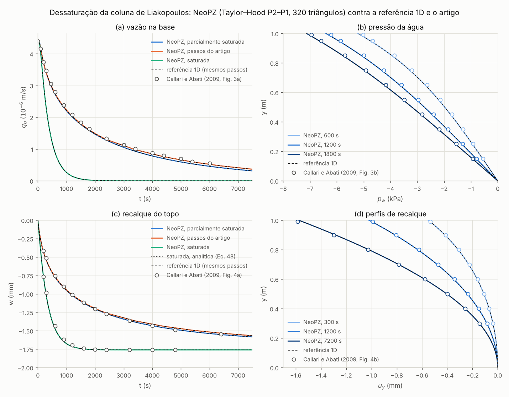

# LearningLiakopoulos: dessaturação de uma coluna de areia

Exemplo da Seção 10 do resumo "Solos não saturados: formulação u–p_w–p_a": o ensaio de drenagem de Liakopoulos
(1965), como na Seção 4.1 de Callari e Abati (2009), com o material `TPZMatUnsaturatedUPwPa` e ar passivo
(p_a = 0). O programa segue os passos do `LearningMohrCoulomb` (malha geométrica, malha computacional, matriz
estrutural e solver, análise e pós-processamento) e grava CSVs que o `plot_liakopoulos.py` compara com a referência
1D, com a solução analítica da coluna saturada e com as curvas digitalizadas do artigo.

## O ensaio (Seções 10.1 a 10.3 e 10.7)

* Coluna de 0,10 × 1,00 m: laterais com rolete (u_x = 0) e impermeáveis, base fixa e drenante (p_w = 0), topo livre
  e impermeável para t ≥ 0. Para t < 0, fluxo permanente para baixo com p_w = 0 em toda a coluna (gradiente
  unitário, vazão q_b = k_s). A coluna drena por gravidade, a sucção cresce de baixo para cima e o esqueleto recalca.
* E = 1300 kPa, ν = 0,4, α = 1, 1/N = 0, n = 0,2975, K_w = 2,0·10⁶ kPa, k_s = 9,81 × 4,5·10⁻⁷ = 4,4145·10⁻⁶ m/s,
  γ = 16,677 kN/m³ constante, χ = S_w. Mohr–Coulomb com c' = 10⁵ kPa: o esqueleto fica elástico (o programa conta
  os pontos plásticos em todos os passos).
* Leis de Liakopoulos: S_w = 1 − c_L p_c^b_L com c_L = 1,9722·10⁻¹¹ × 1000^2,4279 = 3,7901·10⁻⁴ kPa^−b_L,
  b_L = 2,4279 e S_wr = 0; k_rw = 1 − d_L (1 − S_w)^e_L com d_L = 2,207 e e_L = 1,0121. Coluna saturada: c_L = 0
  (S_w = 1, C_s = 0, k_rw = 1).
* Estado inicial: p_w = p_a = 0, peso em 4 incrementos com as pressões congeladas (Δt = 0) e deslocamentos zerados
  mantendo a tensão efetiva.

## Etapas do programa (`main.cpp`)

| etapa | funções | o que faz |
|---|---|---|
| malha geométrica | `ReadColumnMesh`, `ReadGmshMesh` | lê `meshes/coluna.msh` (Gmsh 4.1, gerada de `meshes/coluna.geo` com `gmsh -2 coluna.geo -o coluna.msh`): 4 × 40 quadrados de 0,025 m, cada um dividido em dois triângulos (320 elementos), grupos físicos Solo, Base, Direita, Topo e Esquerda; grava `coluna.vtk` |
| malha computacional | `CreateColumnCompMesh`, `CreateAtomicMesh`, `UnsatMaterial`, `LiakopoulosParams` | malhas atômicas H1 de u (P2), p_w e p_a (P1) e a malha multifísica com memória: Taylor–Hood P2–P1, 1868 equações |
| matriz estrutural e solver | `CreateAnalysis` | `TPZSkylineNSymStructMatrix` (com MKL, `TPZSpStructMatrix`), LU não simétrica e as tolerâncias do Newton |
| análise | `InitialState`, `RunCase` | estado geostático; transiente até 7500 s com Euler implícito e Newton (`TPZUnsatAnalysis::Solve` e `Accept`), com ar passivo e base drenante |
| pós-processamento | `BaseOutflow`, `WriteHistory`, `WriteProfile`, `PostProcessVTK` | vazão pelas reações da equação da água nos vértices da base (q_b = −Σ R_w,j / (Δt · 0,10 m), antes do `Accept`), CSVs e VTK |

Casos (Seção 10.7, item 6):

| caso | passos de tempo | uso |
|---|---|---|
| `parcial` | 1 s até 60 s, 5 s até 600 s, 10 s até 2000 s e 20 s depois (583 passos, os da referência 1D) | tabela da Seção 10.6 |
| `parcial_meio_passo` | a metade desses (1166 passos) | convergência no tempo |
| `parcial_passos_artigo` | 10 s até 300 s, 100 s até 2400 s e 1000 s depois (57 passos) | comparação com as curvas do artigo |
| `saturada` | os da referência 1D, com c_L = 0 | solução analítica de Terzaghi (Eq. 48) |

## Como rodar

Na pasta de build do NeoPZ (configurado com `-DBUILD_PLASTICITY_MATERIALS=ON -DBUILD_PROJECTS=ON`):

```bash
cd Projects/LearningLiakopoulos
```

```bash
./LearningLiakopoulos
```

roda os quatro casos (cerca de 4 min; `./LearningLiakopoulos parcial saturada` roda só os casos dados). Depois, na
mesma pasta:

```bash
python3 plot_liakopoulos.py
```

imprime as tabelas de comparação e grava `comparacao.csv` e `liakopoulos.png`. O CMake copia para a pasta de build o
`plot_liakopoulos.py`, a referência 1D `coluna_liakopoulos_1d.py` e `data/callari2009_fig3_fig4_digitalizado.csv`;
o pós-processamento usa numpy, scipy, pandas e matplotlib.

Saídas do programa:

* `historico.csv`: `caso, passo, t_s, dt_s, newton, qb_m_s, w_topo_m, pw_meio_kPa, pw_topo_kPa, pontos_plasticos`,
  uma linha por passo (t = 0 é o fluxo permanente inicial, q_b = k_s); p_w e w na vertical x = 0,05 m;
* `perfis.csv`: `caso, t_s, x_m, y_m, pw_kPa, uy_m, Sw` nos 41 nós da vertical x = 0,05 m, em t = 0, 300, 600, 1200,
  1800, 3600, 6400, 7200 e 7500 s (quando um passo cai no instante: os passos do artigo não passam por 3600 e 7200 s);
* `coluna.vtk` (malha geométrica) e `coluna_<caso>_pontos.scal_vec.<k>.vtk` para `parcial` e `saturada` (k = 0 é o
  estado inicial, depois os instantes dos perfis): deslocamento, p_w, sucção, S_w, k_rw, p_B e tensões efetivas.

## Resultados (01/11/2026)



Tabela da Seção 10.6, NeoPZ com os passos da referência e, entre colchetes, a referência 1D (coluna parcialmente
saturada) e a Eq. (48) (coluna saturada):

| t (s) | q_b (10⁻⁶ m/s) | p_w em y = 0,5 m (kPa) | p_w no topo (kPa) | w (mm) | saturada: q_b (10⁻⁶ m/s) | saturada: w (mm) |
|---|---|---|---|---|---|---|
| 300 | 3,373 [3,373] | −1,30 [−1,30] | −4,15 [−4,15] | −0,550 [−0,550] | 2,236 [2,223] | −1,038 [−1,042] |
| 600 | 2,727 [2,726] | −1,98 [−1,98] | −5,22 [−5,22] | −0,774 [−0,774] | 0,891 [0,879] | −1,473 [−1,476] |
| 1200 | 2,011 [2,011] | −2,74 [−2,74] | −6,41 [−6,41] | −1,020 [−1,020] | 0,143 [0,138] | −1,714 [−1,716] |
| 1800 | 1,578 [1,578] | −3,20 [−3,20] | −7,13 [−7,13] | −1,167 [−1,167] | 0,023 [0,022] | −1,753 [−1,754] |
| 3600 | 0,877 [0,877] | −3,95 [−3,95] | −8,31 [−8,31] | −1,401 [−1,401] | 0,000 [0,000] | −1,761 [−1,761] |
| 6400 | 0,411 [0,411] | −4,46 [−4,46] | −9,10 [−9,10] | −1,553 [−1,553] | 0,000 [0,000] | −1,761 [−1,761] |
| 7500 | 0,312 [0,312] | −4,57 [−4,57] | −9,27 [−9,27] | −1,585 [−1,585] | 0,000 [0,000] | −1,761 [−1,761] |

* **Contra a referência 1D com os mesmos passos** (máximo em todos os passos e perfis): |Δq_b| ≤ 0,012% de k_s,
  |Δw| ≤ 0,1 µm e |Δp_w| ≤ 0,0025 kPa, nos três casos parcialmente saturados; na saturada, 0,015% de k_s. A malha de
  320 triângulos já reproduz a referência de 201 nós.
* **Saturada contra a Eq. (48)**: |Δw| ≤ 0,004 mm e |Δq_b| ≤ 0,31% de k_s. A diferença na vazão é o erro do Euler
  implícito (cerca de λ² Δt t / 2 = 1,4% em 600 s, com λ = (π/2)² c_v/H² e Δt = 5 s), o mesmo da referência 1D com
  esses passos.
* **Convergência no tempo**: com metade do passo, q_b muda até 0,25% (no fim, quando a vazão é pequena), w e p_w menos
  de 0,07%; a referência 1D muda exatamente o mesmo.
* **Newton**: 2,9 iterações por passo com os passos da referência, 2,7 com a metade, 3,4 com os passos do artigo e
  1,7 na saturada (problema linear). Nenhum ponto plástico: o esqueleto ficou elástico.
* **Contra as curvas digitalizadas de Callari e Abati (2009)** (média nos pontos; incerteza de leitura de cerca de 1%
  da faixa de cada eixo):

| | q_b, t < 2400 s (média \|Δ\|) | q_b, t ≥ 2400 s (média) | p_w (média) | w (média \|Δ\|) | w saturada (média \|Δ\|) | u_y (média \|Δ\|) |
|---|---|---|---|---|---|---|
| NeoPZ, passos da referência | 2,0% | −10,6% | −0,061 kPa | 0,010 mm | 0,015 mm | 0,006 mm |
| NeoPZ, passos do artigo | 1,4% | −3,5% | −0,039 kPa | 0,014 mm | 0,015 mm | 0,003 mm |
| referência 1D | 2,0% | −10,7% | −0,062 kPa | 0,010 mm | 0,017 mm (Eq. 48) | 0,006 mm |

  O que o resumo pede (Seção 10.6) é atendido: com passos finos o NeoPZ coincide com a referência 1D convergida; com
  os passos do artigo a vazão tardia fica 3,5% abaixo da do artigo (forma secante e pressão de Bishop); as pressões e
  os recalques ficam a 0,04 kPa e 0,014 mm das curvas do artigo (esperado: cerca de 0,1 kPa e 0,03 mm). Com os passos
  da referência, como na referência 1D, a vazão do artigo é cerca de 10% maior depois de 2400 s: é efeito do passo de
  tempo do artigo, não da física.
