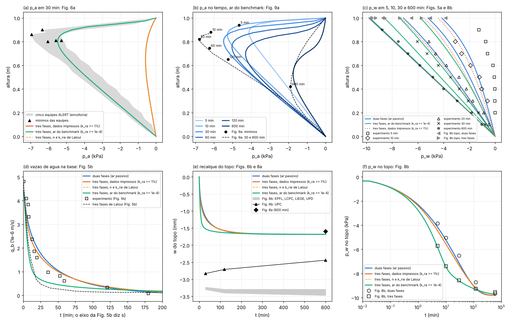

# V1_LiakopoulosTrifasico: coluna de Liakopoulos com ar passivo e ativo

Referência: L. Laloui, G. Klubertanz e L. Vulliet (2003), *Solid–liquid–air coupling in multiphase porous media*,
Int. J. Numer. Anal. Meth. Geomech. 27:183–206, doi:10.1002/nag.269 (Seção 5, Tabela I, Figs. 5, 6, 8 e 9).

## O caso

O ensaio de drenagem de Liakopoulos (1965): uma coluna de areia Del Monte de 1 m, saturada, com fluxo permanente para
baixo (água entrando pelo topo e saindo livremente pela base). Em t = 0 a alimentação para e a coluna drena por
gravidade, com o topo e a base abertos para a atmosfera. As laterais são rígidas e impermeáveis à água e ao ar. Não há
carga mecânica. O artigo compara até 600 min o modelo de três fases (u–p_w–p_g, ar ativo) com o experimento (p_w e
vazão, Fig. 5), com as outras quatro equipes do benchmark europeu ALERT (p_a e recalque, Fig. 6) e com o modelo de
duas fases (ar passivo, p_g = 0; Figs. 8 a 10).

No NeoPZ (`TPZMatUnsaturatedUPwPa` com Taylor–Hood P2–P1, Euler implícito e Newton de `TPZUnsatAnalysis`):

- **variante ii, ar passivo** (`bifasico`): p_a = 0 em todos os nós. É o porte do projeto `LearningLiakopoulos` (branch
  `UnsaturatedSoil`), validado contra Callari e Abati (2009) e contra uma referência 1D. Mesma malha, mesmos
  parâmetros, mesmo estado inicial, mesmos passos e mesma vazão pelas reações.
- **variante i, ar ativo** (`trifasico`): p_a incógnita, com p_a = 0 no topo e na base e as laterais impermeáveis.
  O solo e a água são os do caso de ar passivo, de modo que a comparação duas × três fases isola o efeito do ar, como
  na Seção 5.3 do artigo. O ar usa os dados de Laloui et al. (Tabela I e Seções 3.3 e 5).
- dois casos de sensibilidade com ar ativo:
  - `trifasico_laloui`: o caso `trifasico` com n = 0,297 e k_rw = S_e³ (Eq. 59), o que a Tabela I e a Seção 3.3
    dão e a biblioteca tem;
  - `trifasico_alert`: o caso `trifasico` com a lei do ar usual do teste de Liakopoulos na literatura do benchmark
    (Brooks–Corey com λ = 3, S_e = (S_w − 0,2)/0,8 e k_ra ≥ 10⁻⁴; Schrefler e Zhan 1993, Schrefler e Scotta 2001).
    Esses dados não estão em Laloui et al.: o caso serve para explicar a discrepância da Fig. 6a (ver a discussão).

Geometria e contorno: coluna de 0,10 × 1,00 m (`malhas/coluna.msh`, 4 × 40 quadrados de 0,025 m divididos em dois
triângulos, 320 elementos, 1868 equações). Base engastada, laterais com rolete e topo livre. Água: p_w = 0 na base, e
topo e laterais impermeáveis. Estado inicial: p_w = p_a = 0 (o fluxo permanente com gradiente unitário, vazão k_s, e a
p_w uniforme que o artigo diz seguir de Gawin et al.). O peso entra com as pressões congeladas e os deslocamentos são
zerados mantendo a tensão efetiva. Os perfis são tirados na vertical x = 0,05 m.

## Dados

| grandeza | valor usado | fonte / suposição |
|---|---|---|
| E, ν | 1300 kPa, 0,4 | Tabela I (= Callari e Abati 2009); elástico linear (Mohr–Coulomb com c' = 10⁵ kPa; nenhum ponto plástico) |
| n | 0,2975 (`trifasico_laloui`: 0,297) | Callari e Abati; Tabela I dá 0,297 (diferença de 0,17%, sem efeito visível) |
| k_s | 4,4145·10⁻⁶ m/s | k = 4,5·10⁻¹³ m², μ_w = 10⁻³ Pa s, ρ_w = 1000 kg/m³, g = 9,81 m/s² (Tabela I): k ρ_w g/μ_w |
| grãos, água | incompressíveis (α = 1), K_w = 2·10⁶ kPa | Laloui: grãos e água incompressíveis; K_w do LearningLiakopoulos (efeito desprezível) |
| peso | γ = 16,68 kN/m³ constante | só no estado geostático, que é zerado; com γ constante a tensão total não muda (Eq. 62c não tem peso) |
| Bishop | χ = S_w | Eq. 39 do artigo |
| retenção | Liakopoulos: S_w = 1 − 3,79·10⁻⁴ p_c^2,4279 (kPa) | **suposto**: a de Seker (Eq. 55, Ψ₀ = 3,1, Ψ₁ = 0,18, c_d = 100 m⁻¹) não existe na biblioteca. As duas diferem até 0,02 em S_w entre 0 e 10 kPa (5 kPa: 0,965 Seker, 0,981 Liakopoulos) |
| k_rw | 1 − 2,207 (1 − S_w)^1,0121 (`trifasico_laloui`: S_e³) | Liakopoulos; Eq. 59 com S_r^r = 1%. O fator k_rwn = (n/n₀)⁷ (Eq. 60) foi omitido (n constante no modelo) |
| k_ra | (1 − S_e)³, S_e = (S_w − 0,01)/0,99, k_ra ≥ 0,01 | Eq. 61, S_r^r = 1% (Seção 5.1), mínimo de 1% (Seção 5.2): Brooks–Corey da biblioteca com λ = 10⁶ |
| μ_w/μ_a | 55,6 | μ_a = 1,8·10⁻⁵ Pa s (Tabela I) |
| γ_a | 9,81·10⁻³ kN/m³ | ρ_g = 1 kg/m³ (Tabela I) |
| compressibilidade do ar | 1/(p_a + 101,325 kPa), gás ideal | **suposto**: o M_g impresso (0,5·10⁻⁶ (kN/m²)⁻¹, Eq. 28) é 20 000 vezes menor que o do ar a 1 atm. Na coluna o termo n S_a/p_abs é ~2% da capacidade de retenção n dS/dp_c, então a escolha pesa pouco |
| limites numéricos do artigo | não reproduzidos | S_r ≤ 99% e variação de k_rw ≤ 5% por passo (Seção 5.2) não existem na biblioteca |
| passos | 1 s até 60 s, 5 s até 600 s, 10 s até 2000 s, 20 s até 7500 s, 60 s até 36 000 s (1058 passos) | os do LearningLiakopoulos, estendidos; o artigo não dá malha nem passos |

## Compilar e rodar

```bash
cmake --build <build> --target V1_LiakopoulosTrifasico V1_testes
cd <pasta de saída>
<build>/Projects/V1_LiakopoulosTrifasico/V1_LiakopoulosTrifasico
```

O comando roda os quatro casos até 600 min, cerca de 2,5 min por caso num núcleo. Variáveis de ambiente:

- `CASO`: `bifasico`, `trifasico`, `trifasico_laloui`, `trifasico_alert`, uma lista separada por vírgulas, ou
  `todos` (padrão);
- `T_FIM`: fim do transiente em s (padrão 36000);
- `NY`: 0 é a malha do Gmsh 4 × 40 (padrão); n > 0 é a malha estruturada 4 × n de `UnsatModel.h`, para o estudo de
  malha;
- `DT_FATOR`: multiplica os passos (padrão 1);
- `VTK=1`: grava VTK nos instantes dos perfis.

Saídas na pasta corrente:

- `historico.csv`: por passo, a vazão de água na base, as vazões de ar no topo e na base, o recalque do topo, p_w no
  meio e no topo, e o mínimo de p_a com a sua altura;
- `perfis.csv`: p_w, p_a, sucção, S_w e u_y na vertical, em 0, 5, 10, 20, 30, 60, 106,7, 120, 125 e 600 min;
- `resumo.csv`: uma linha por caso;
- `resultado.txt`: `casos=… situacao=ok pa_min_30min=… seg=…`, gravado por último.

A figura e a tabela "artigo × nosso" saem de `python3 scripts/plot_v1.py <pasta>` (numpy e matplotlib), que grava
`figuras/v1_comparacao.png`.

**No cluster (SLURM, fermi):**

```bash
cd Projects/V1_LiakopoulosTrifasico/cluster
source ../../Cluster/modulos.sh && ./compilar_v1.sh
sbatch v1.sbatch
```

`compilar_v1.sh` roda no nó de login, que tem cmake, e compila em `build_verif`. `v1.sbatch` roda os quatro casos em
paralelo (4 núcleos, um processo por caso) em `$DATA/v1` ou em `./resultados_v1`, junta os CSVs e faz a figura se
houver numpy e matplotlib. Ele aceita `CASOS`, `T_FIM`, `NY`, `DT_FATOR`, `SAIDA`, `BUILD` e, com `TESTES=1`, roda
também os testes, inclusive os `[.lento]`. Exemplo:

```bash
CASOS="bifasico trifasico_alert" TESTES=1 sbatch v1.sbatch
```

## Testes (`testes.cpp`, Catch2, marca `[V1]`)

Os padrão rodam três casos até 30 min (cerca de 45 s cada). Os de 600 min têm a marca `[.lento]`:
`V1_testes "[.lento]"`.

| teste | compara | tolerância (justificativa) | resultado (06/11/2026) |
|---|---|---|---|
| k_ra = (1 − S_e)³ com S_r^r = 1% e k_ra ≥ 1% | lei da biblioteca com λ = 10⁶ contra a Eq. 61 | 10⁻⁵ relativa (erro de λ finito) | passou, 0 s |
| ar passivo reproduz o LearningLiakopoulos | q_b, p_w(0,5 m), p_w(topo), w em 300, 600, 1200 e 1800 s contra a tabela validada; perfis, vazão e recalque contra Callari e Abati | meia unidade do último dígito impresso; 0,1 kPa, 3% e 0,03 mm contra o artigo (leitura de 1% da faixa mais a diferença já obtida) | passou, 40 s (coincide com a tabela em todos os dígitos impressos) |
| ar ativo, lei do ar do benchmark: p_a em 30 min na faixa das cinco equipes (Fig. 6a) | perfil inteiro dentro da envoltória; mínimo dentro dos mínimos das equipes | 0,15 kPa (largura dos marcadores) e 0,025 m (um elemento) | passou, 45 s |
| ar ativo, lei do ar do benchmark: p_w no topo e diferença duas × três fases (Figs. 5a e 8b) | 5, 10 e 30 min | 0,8 kPa na diferença (o nosso modelo de duas fases fica até 0,63 kPa do de Laloui, que usa a retenção de Seker); 0,5 kPa no p_w de três fases (as Figs. 5a e 8b do artigo diferem em 0,4 kPa) | passou, 0 s |
| ar ativo com os dados impressos: p_a em 30 min na faixa da Fig. 6a (`[!shouldfail]`) | mínimo de p_a e diferença duas × três fases | as mesmas | **falha** (−0,58 kPa contra −6,95 a −5,28 kPa; diferença −0,20 contra −2,06 kPa). Fica no ctest como falha esperada: se passar a concordar, o teste acusa. 44 s |
| `[.lento]` 600 min: mínimos de p_a no tempo (Fig. 9a) e p_w hidrostático no fim (Fig. 5a) | lei do ar do benchmark: mínimo em 5, 10, 30, 60, 120 e 600 min; p_w em 600 min contra o experimento e −γ_w y | 1,7 kPa (dispersão das equipes em 30 min) e 0,07 m; 0,4 kPa (dispersão do experimento em torno da hidrostática) e 0,1 kPa | **falhou numa asserção** (64 de 65 passaram), 4 min 50 s: a altura do mínimo em 600 min é 0,525 m, contra 0,42 m (diferença de 0,105 m, tolerância de 0,07 m). Os valores dos mínimos passaram em todos os instantes (diferença de 0,15 a 1,31 kPa). O mínimo de 600 min é achatado: a curva digitalizada varia 0,11 kPa entre 0,34 e 0,50 m, e o nosso p_a em 0,42 m fica 0,14 kPa acima do nosso mínimo. O p_w de 600 min passou: a até 0,09 kPa da hidrostática (duas fases: 0,001 kPa) e a até 0,33 kPa do experimento |

Total dos testes padrão: 2 min 8 s (5 casos de teste: 4 passaram e 1 falhou como esperado; 124 asserções). O teste
`[.lento]` leva 4 min 50 s.

## Resultados: artigo × nosso (malha 4 × 40, passos acima)



| grandeza | artigo (digitalizado) | duas fases | três fases, dados impressos | três fases, ar do benchmark |
|---|---|---|---|---|
| mín. p_a em 5 min (Fig. 9a) | −4,65 kPa em 0,94 m | — | −0,74 em 0,70 | −4,13 em 0,875 |
| mín. p_a em 10 min | −6,17 em 0,88 | — | −0,78 em 0,675 | −5,28 em 0,85 |
| mín. p_a em 30 min (Fig. 9a / Fig. 6a, cinco equipes) | −6,80 em 0,82 / −6,95 a −5,28 em 0,80–0,90 | — | −0,58 em 0,65 | −5,49 em 0,80 |
| mín. p_a em 60 min | −6,25 em 0,745 | — | −0,37 em 0,65 | −5,04 em 0,75 |
| mín. p_a em 120 min | −5,25 em 0,65 | — | −0,17 em 0,625 | −4,31 em 0,70 |
| mín. p_a em 600 min | −1,89 em 0,42 | — | −0,001 | −1,74 em 0,525 |
| p_w no topo, 5 min (Fig. 8b: duas / três fases) | −3,85 / −5,70 | −4,15 | −4,44 | −5,81 |
| p_w no topo, 10 min | −5,03 / −7,39 | −5,22 | −5,55 | −7,43 |
| p_w no topo, 30 min | −6,50 / −8,56 (Fig. 5a: −8,96) | −7,13 | −7,33 | −8,61 |
| p_w no topo, 120 min | −8,72 / −9,26 | −9,23 | −9,19 | −9,32 |
| p_w no topo, 600 min | −9,66 / −9,55 | −9,81 | −9,81 | −9,72 |
| vazão na base, 10 / 30 / 60 min (Fig. 5b, experimento) | ≈ 2,9 / 1,2 / 0,6 ·10⁻⁶ m/s | 2,73 / 1,58 / 0,88 | 2,47 / 1,46 / 0,85 | 1,36 / 0,60 / 0,41 |
| vazão na base, 10 / 30 / 60 min (Fig. 5b, três fases de Laloui) | ≈ 1,7 / 0,41 / 0,23 | | | |
| recalque do topo em 600 min (Fig. 8a / Fig. 6b) | ≈ 1,6 mm / 3,3–3,5 mm (UPC 2,4) | 1,68 | 1,68 | 1,68 |

**Convergência** (30 min, `NY=80` e `DT_FATOR=0.5`). Com a malha 4 × 80, o caso com a lei do benchmark dá o
mínimo de p_a de −5,507 kPa em 0,8125 m (−5,489 kPa em 0,80 m com 4 × 40), p_w no topo de −8,606 kPa (−8,615) e
q_b de 0,600·10⁻⁶ m/s (0,598). Com metade dos passos: −5,491 kPa, −8,616 kPa e 0,597·10⁻⁶ m/s. O caso com os dados
impressos dá −0,5848 kPa com 4 × 80 (−0,5846 com 4 × 40). As diferenças com o artigo não vêm da discretização.
Nenhum passo precisou de corte, com 2,5 a 3,3 iterações de Newton por passo.

O caso `trifasico_laloui` dá praticamente o mesmo que `trifasico` (Δp_w ≤ 0,01 kPa; Δq_b ≤ 0,4% até 120 min e 3,5%
no fim, com a vazão quase nula): n = 0,297 e k_rw = S_e³ quase não mudam nada perto da saturação.

### Discussão

- **Ar passivo.** O porte reproduz a tabela validada do LearningLiakopoulos em todos os dígitos impressos. Contra as
  curvas de Callari e Abati, a média de p_w − p_w,artigo é −0,06 kPa e a média de |Δq_b|/q_b é 2%. Contra o modelo de
  duas fases de Laloui (Fig. 8b), o nosso p_w no topo fica 0,2 a 0,6 kPa mais negativo até 30 min e chega à
  hidrostática (−9,81 kPa) em 600 min. Ele usa a retenção de Seker com S_r ≤ 99%, e nós a de Liakopoulos.
- **Fig. 6a com os dados impressos: não concorda.** Com k_ra = (1 − S_e)³ ≥ 1% e a lei de Darcy do ar com a
  permeabilidade intrínseca k, k_ra fica no piso de 1% em toda a coluna (S_w > 0,79). A mobilidade do ar é então
  (μ_w/μ_a) k_ra = 0,56 da mobilidade da água saturada. O ar que substitui a água drenada (1,28·10⁻⁶ m/s em 30 min:
  0,99 pelo topo e 0,29 pela base) entra pelas duas extremidades com um gradiente pequeno, Δp_a ≈ q L/(k k_ra/μ_a) ≈ 0,8 kPa. O nosso mínimo
  é −0,58 kPa, cerca de 10 vezes menor que os −5,3 a −7,0 kPa das cinco equipes. Pela mesma razão, o efeito do ar
  sobre a água é pequeno: a diferença duas × três fases no topo é de −0,2 a −0,3 kPa, contra −1,9 a −2,4 kPa na Fig. 8b.
- **Fig. 6a com a lei do ar do benchmark: concorda.** Com k_ra ≥ 10⁻⁴ (Brooks–Corey, λ = 3, S_wr = 0,2), k_ra vale
  10⁻⁴ a 3·10⁻³ na coluna. Assim:
  - o perfil de p_a em 30 min cai inteiro dentro da envoltória das cinco equipes, com mínimo de −5,49 kPa em 0,80 m
    (equipes: −5,28 a −6,95 kPa em 0,80 a 0,90 m);
  - o p_w no topo de três fases fica a 0,11 kPa ou menos da Fig. 8b em 5, 10 e 30 min, e a diferença duas × três
    fases (−1,7, −2,2 e −1,5 kPa) fica perto da do artigo (−1,9, −2,4 e −2,1 kPa);
  - a vazão cai depressa, como na Fig. 5b, e o p_a volta a −1,74 kPa em 0,53 m em 600 min (Fig. 9a: −1,89 kPa em
    0,42 m).

  Os nossos mínimos de p_a ficam 0,5 a 1,3 kPa menos negativos que os da Fig. 9a (EPFL) até 120 min, e 0,15 kPa
  em 600 min. A diferença é menor que a
  dispersão das equipes (1,7 kPa) e que a diferença entre as próprias Figs. 6a e 9a do EPFL em 30 min (−6,04 e
  −6,80 kPa). A conclusão é que a faixa publicada corresponde a uma permeabilidade efetiva do ar da ordem de 10⁻⁴ a
  10⁻³, e não ao piso de 1% impresso. Uma explicação possível dentro do próprio artigo é a matriz de fluxo do gás da
  Eq. (68), H_g = ∫(1 − S_r) K* ∇N ∇N. Ela multiplica K* por (1 − S_r), que vale 0,01 a 0,1 na coluna, e dá
  k_ra,ef = 0,01 (1 − S_r) ≈ 10⁻⁴ a 10⁻³, a mesma ordem da lei do benchmark. Isso não pode ser reproduzido sem mudar
  a biblioteca.
- **Vazão (Fig. 5b).** O eixo diz "Time [s]", mas a vazão do ensaio cai em horas: lemos em minutos. O experimento cai
  mais depressa que o nosso modelo de duas fases (2,37 contra 2,48·10⁻⁶ m/s em 13 min, e 0,61 contra 0,89 em
  59 min). O três fases de Laloui e o nosso com a lei do benchmark caem mais depressa que o experimento no início.
- **Recalque (Figs. 6b e 8a).** Todos os nossos casos chegam a 1,68 mm em 600 min, o mesmo da Fig. 8a do artigo
  (≈ 1,6 mm) e de Callari e Abati. O benchmark da Fig. 6b dá 3,3 a 3,5 mm (UPC 2,4 mm). O artigo não explica a
  diferença entre as suas duas figuras; com E = 1300 kPa e ν = 0,4 (módulo edométrico de
  2786 kPa), 3,3 mm exigiria um módulo com a metade desse valor ou o dobro da variação de p_B.
- **O que não foi reproduzido:**
  - a retenção de Seker, o limite S_r ≤ 99% (com ele não há dessaturação abaixo de 2,2 kPa de sucção) e o limite de
    5% na variação de k_rw;
  - o fator (n/n₀)⁷ em k_rw;
  - o M_g impresso.

  Todos mudam a dessaturação inicial; nenhum foi ajustado.
- **Teste 2 (Klubertanz et al., coluna de 1,2 m): não feito.** Ele precisa da retenção de Seker (Ψ₁ = 0,05, muito
  íngreme) e da elasticidade não linear de Duncan–Chang (Eq. 54). Nenhuma das duas existe na biblioteca, e os
  parâmetros que faltam (S_r^r, o expoente n de Duncan–Chang, o nível inicial da água) teriam de ser supostos.

Os dados digitalizados (aproximados, com a figura de origem e a incerteza de leitura) estão em `dados/`:

- `laloui2003_fig5.csv`: experimento e três fases (Fig. 5a), vazão (Fig. 5b);
- `laloui2003_fig6a_pa_30min.csv`: envoltória e mínimos das cinco equipes;
- `laloui2003_fig8b_pw_topo.csv`: p_w no topo, duas e três fases;
- `laloui2003_fig9a_pa.csv`: mínimos de p_a no tempo e as curvas de 30 e 600 min;
- `laloui2003_fig6b_8a_recalque.csv`: recalque do topo;
- `callari2009_fig3_fig4_digitalizado.csv`: o arquivo do LearningLiakopoulos.

## Arquivos

- `problema.h`: parâmetros, casos, malha, estado inicial, transiente, sondas, CSVs e leitura dos dados;
- `main.cpp`: o executável;
- `testes.cpp`: os testes;
- `malhas/coluna.geo` e `malhas/coluna.msh`: a malha, com `gmsh -2 coluna.geo -o coluna.msh`;
- `dados/`: as curvas de referência;
- `scripts/plot_v1.py`: figura e tabela;
- `figuras/v1_comparacao.png`: a figura;
- `cluster/`: compilação e job SLURM.
