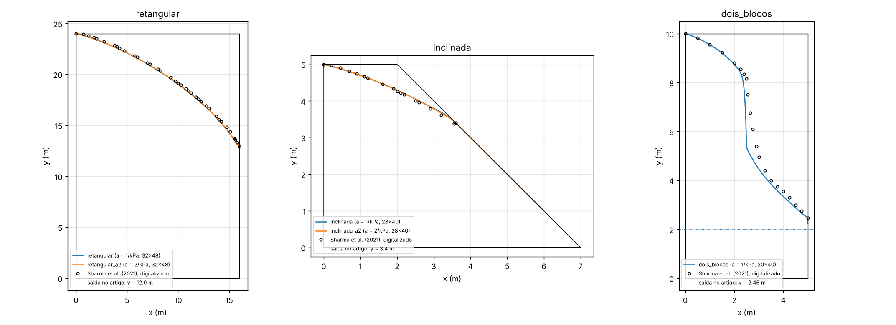

# V3_SuperficieLivre: percolação permanente com superfície livre e face de percolação

Referência: V. Sharma, K. Fujisawa e A. Murakami (2021), *Space-Time Finite Element Method for Transient and
Unconfined Seepage Flow Analysis*, Finite Elements in Analysis and Design 197:103632,
doi:10.1016/j.finel.2021.103632 (Seção 4, Figs. 6, 7, 13, 14, 16 e 17).

## O caso

O artigo resolve o fluxo não confinado só na região saturada, com a pressão piezométrica como incógnita e uma malha
móvel (o contorno freático anda com a velocidade de Darcy), até o regime permanente. Os exemplos usados aqui:

| exemplo | geometria | níveis | resultado publicado |
|---|---|---|---|
| 4.1 `retangular` | retângulo 16 × 24 m (Fig. 6a) | montante 24 m, jusante 4 m | saída na face a jusante 8,9 m acima do nível de jusante (y = 12,9 m); linha freática (Fig. 7) |
| 4.2 `inclinada` | base 7 m, face a montante vertical de 5 m, crista 2 m, face a jusante reta de (2, 5) a (7, 0) (Fig. 13a) | montante 5 m, jusante 1 m | saída em y = 3,4 m, face de percolação de 2,4 m; linha freática (Fig. 14) |
| 4.3 `dois_blocos` | retângulo 5 × 10 m, interface vertical em x = 2,5 m, k esquerdo = k direito / 10 (Fig. 16a) | montante 10 m, jusante 2 m | a linha cruza a interface a 8,05 m; saída 0,46 m acima do nível de jusante (y = 2,46 m) (Fig. 17) |

O exemplo 4.4 (barragem zoneada com dreno de pé) não foi feito: o artigo só tem resultados gráficos, sem comparação
com outras referências.

**Verificação forte adicional (exata).** Para faces a montante e a jusante verticais e base e topo sem fluxo, a vazão
é exatamente a de Dupuit, qualquer que seja a superfície livre (prova de Charny): q = K (H1² − H2²) / (2 L). Para o
caso 4.1, q = 17,5 K = 1,7168·10⁻² m³/s por metro. A prova vale também para blocos em série (caso 4.3):
q = (H1² − H2²) / (2 Σ L_i/K_i) = 1,7123·10⁻³ m³/s por metro. O artigo não dá a vazão.

## O nosso modelo (variante iii)

`TPZMatUnsaturatedUPwPa` com o esqueleto rígido e não acoplado (todos os deslocamentos presos em zero,
`SetHydroMechanicalCoupling(false)`), o ar à pressão atmosférica (p_a = 0 em todos os nós) e o fluxo de Richards só
na água (P1), com Euler implícito e o Newton de `TPZUnsatAnalysis`. A malha é fixa e cobre todo o domínio. O solo é
não saturado, e a superfície livre é a isolinha p_w = 0. Para que o resultado se aproxime do fluxo saturado com
superfície livre nítida, usamos:

- uma curva de retenção muito íngreme: van Genuchten S_e = [1 + (a p_c)^b]^(1/b − 1) com a = 1 kPa⁻¹ e b = 3. A
  franja capilar tem espessura da ordem de 1/(a γ_w) = 0,1 m;
- uma permeabilidade não saturada pequena: k_rw = S_e³, com k_rw ≥ 10⁻⁹.

Tentamos primeiro Gardner (S_e = exp(−a p_c)). O Newton entra em ciclo de período 2 já no primeiro passo, por causa
do bico de S e de k em p_c = 0. O van Genuchten com b > 1 tem derivada nula em p_c = 0, e o Newton converge
quadraticamente. Gardner continua disponível (`RET=gardner`).

O regime permanente é alcançado por um pseudo-transiente a partir do estado hidrostático com o nível de montante em
todo o domínio (o "modelo A" do artigo; `CI=linear` dá o nível reto de H1 a H2). O passo começa em 1 s e cresce
1,5 vez por passo até 10⁵ s. Para quando |q_entra − q_sai| / q_entra < 10⁻⁴ por 3 passos seguidos com a mesma face de
percolação. O passo que não converge é dividido ao meio, até 8 vezes.

Contornos da água:

- x = 0: p_w = γ_w (H1 − y);
- face a jusante até o nível de jusante: p_w = γ_w (H2 − y);
- face a jusante acima do nível de jusante, e a crista: face de percolação, com a lógica do `passo()` do
  `SlopeRandomField` (branch `UnsaturatedSoil`), sem chuva. Um nó livre (fluxo nulo) com p_w > 10⁻⁶ kPa passa a
  p_w = 0. Um nó com p_w = 0 em que a água entraria (R_w/(Δt L) > 10⁻¹² m/s) volta a fluxo nulo. O passo só é aceito
  quando o conjunto não muda;
- base impermeável.

As vazões são as reações nodais R_w/Δt dos nós com p_w imposto: entrada a montante, saída abaixo do nível de jusante,
saída pela face de percolação e saída pela crista (nula no regime permanente).

**A identidade de Charny com a franja capilar.** No solo não saturado, a mesma prova vale com o potencial de Kirchhoff
Φ̃(P) = ∫₀^P k_rw ds (P = p_w/γ_w):

q Σ L_i/K_i = H1²/2 − H2²/2 − ∫ Φ̃(P) dy,

com a integral na face a jusante acima do ponto de saída, onde há sucção e Φ̃ < 0. O código calcula essa vazão
corrigida (`q_DC_corr`) com as sucções nodais da face, e também o limite a priori do acréscimo,
(topo − H2) |Φ̃(−∞)| / Σ L_i/K_i (`q_franja_max`). A diferença entre a nossa vazão e `q_DC_corr` é só o erro de
discretização. A diferença entre `q_DC_corr` e Dupuit-Charny é o efeito físico da franja, que some quando a → ∞.

Ponto de saída: entre o nó mais alto da face de percolação (p_w = 0, com saída) e o nó seguinte (fluxo nulo, p_w < 0).
A estimativa é o ponto médio, com incerteza de meio espaçamento. Linha freática: a isolinha p_w = 0 numa vertical,
com p_w linear em cada triângulo.

Malha: estruturada, de triângulos com a diagonal alternada, pelo mapa bilinear do quadrilátero A(0,0), B, D, E. As
linhas de nós são horizontais (yD = yE), o nível de jusante cai num nó e a interface do caso 4.3 cai numa coluna de
nós.

## Dados

| grandeza | valor usado | fonte / suposição |
|---|---|---|
| geometria e níveis | tabela acima | Figs. 6a, 13a, 16a e texto da Seção 4 |
| K | 9,81·10⁻⁴ m/s (4.3: 9,81·10⁻⁵ à esquerda) | k = 10⁻¹⁰ m² (10⁻¹¹ m²), μ_w = 10⁻³ Pa s, ρ_w = 1000 kg/m³, g = 9,81 m/s² (Seção 4): K = k ρ_w g/μ_w. A posição da superfície livre não depende de K, e a vazão é proporcional a K |
| retenção | van Genuchten a = 1 kPa⁻¹, b = 3, S_wr = 0 | **nossa**: o artigo não tem zona não saturada. Sensibilidade com a = 0,5, 2 e 4 kPa⁻¹ (abaixo) |
| k_rw | S_e³, ≥ 10⁻⁹ | **nossa** (idem) |
| porosidade | 0,3 | **suposta**: só muda o pseudo-transiente |
| K_w | 2,2·10⁶ kPa | armazenamento da água (o artigo usa S = 10⁻⁹ Pa⁻¹): só muda o pseudo-transiente |
| estado inicial | hidrostático com o nível de montante | "hydrostatic over the whole domain" (modelo A, Sec. 4.1). A referência não é dada; o regime permanente não depende dela (teste `[.lento]`) |
| passos | 1 s × 1,5ⁿ até 10⁵ s | **nossos** (o Δt e o χ do artigo são do método de malha móvel) |
| malhas | padrão do executável: 4.1 32 × 48 (0,5 m), 4.2 28 × 40 (0,125 m na vertical), 4.3 40 × 80 (0,125 m) | **nossas** (o artigo: 912, 1906 e 5850 triângulos). Testes padrão: 16 × 24 e 14 × 20. Os resultados do 4.3 abaixo são da malha de 20 × 40 (0,25 m; teste `[.lento]`); a de 40 × 80 fica para o cluster |
| linhas freáticas | `dados/sharma2021_fig7_retangular.csv`, `dados/sharma2021_fig14_inclinada.csv`, `dados/sharma2021_fig17_dois_blocos.csv` | digitalizado, aproximado (curva "Present", páginas renderizadas a 400 dpi): Figs. 7 e 14 pelos pixels da linha (~0,05 m), Fig. 17 lida a olho numa grade (~0,1 m) |

## Compilar e rodar

```bash
cmake --build <build> --target V3_SuperficieLivre V3_testes
cd <pasta de saída>
CASO=retangular <build>/Projects/V3_SuperficieLivre/V3_SuperficieLivre
CASO=inclinada AG=2 <build>/Projects/V3_SuperficieLivre/V3_SuperficieLivre
```

Variáveis de ambiente (ver o cabeçalho de `main.cpp`): `CASO` (retangular, inclinada, dois_blocos), `NX`, `NY`, `RX`,
`RET` (vg, gardner), `AG`, `BVG`, `POT`, `KRW_MIN`, `POROS`, `DT0`, `DT_FATOR`, `DT_MAX`, `T_MAX`, `TOL_EST`, `CI`
(hidrostatica, linear), `TOPO_FACE`, `VERBOSE`. Saídas na pasta corrente:

- `passos.csv`: cada passo aceito, com as vazões, o desequilíbrio, os nós da face de percolação, o ponto de saída,
  as tentativas da face e as iterações de Newton;
- `face.csv`: os nós da face a jusante no estado final (p_w, saída por metro e tipo: 0 sem fluxo, 1 percolação,
  2 abaixo do nível de jusante);
- `linha_freatica.csv`: a nossa linha p_w = 0 e a digitalizada;
- `pw.csv` e `triangulos.csv`: p_w nos vértices e a malha;
- `resumo.csv` e `resultado.txt`: uma linha `chave=valor` com `situacao=ok` e `seg=`, gravada por último;
- código de saída 0 se o regime permanente foi alcançado.

Figura e tabela de comparação de várias execuções (uma subpasta cada):
`python3 scripts/plot_v3.py <pasta> --saida v3.png`.

No cluster (fermi, SLURM), de dentro de `cluster/`:

```bash
source ../../Cluster/modulos.sh && ./compilar_v3.sh      # no nó de login (cmake)
sbatch v3.sbatch                                         # 11 execuções, 6 núcleos
EXECUCOES="retangular inclinada dois_blocos" TESTES=1 sbatch v3.sbatch
```

`v3.sbatch` roda cada execução da lista (os três casos, a sensibilidade a `AG`, as malhas finas e o estado inicial
linear) na sua pasta em `$SAIDA`. No fim junta os `resumo.csv`, roda os testes `[.lento]` se `TESTES=1` e faz a
figura.

## Testes

`V3_testes` (Catch2, marca `[V3]`). Os testes padrão usam malhas reduzidas e cada caso roda uma vez por execução:

| teste | compara | tolerância |
|---|---|---|
| malha, linha de um campo linear, dados | área e comprimentos exatos; isolinha de p_w = γ_w (h(x) − y) | 10⁻¹² e 10⁻⁹ |
| 4.1 vazão de Dupuit-Charny (16 × 24) | q contra 17,5 K; q contra a identidade com a franja | 0,3% + limite a priori da franja (0,59%); 0,2% |
| 4.1 ponto de saída e linha (16 × 24) | saída contra y = 12,9 m; linha em 8 abscissas contra a Fig. 7 | meio espaçamento + 0,3 m; 0,35 m |
| 4.1 sensibilidade à curva (a = 0,5, 1 e 2 kPa⁻¹) | o excesso de vazão cai com a; saída estável | < 1%; variação ≤ 1 espaçamento |
| 4.2 face de percolação de 2,4 m (14 × 20) | saída contra y = 3,4 m; linha em 6 abscissas contra a Fig. 14 | meio espaçamento + 0,15 m; 0,12 m |
| `[.lento]` estado inicial | hidrostático × linear: mesma saída, vazão e linha | 0,1% e 0,02 m |
| `[.lento]` malhas do caso completo | 4.1 (32 × 48) e 4.2 (28 × 40) | as de cima, mais estreitas |
| `[.lento]` dois blocos (20 × 40) | cota na interface contra 8,05 m; saída contra 2,46 m; vazão contra a fórmula em série | 0,3 m; meio espaçamento + 0,15 m; 0,3% + franja e 0,2% |

Resultado real (este container, 1 núcleo compartilhado com outro processo, Release com PARDISO): os 5 testes padrão
passaram (3039 verificações) em 92 s; os 3 testes `[.lento]` passaram (51 verificações) em 4 min 13 s.

## Artigo × nosso resultado

Malhas do caso completo, a = 1 kPa⁻¹ (execuções de `main.cpp`; 4.3 na malha de 0,25 m). "Saída" é o intervalo entre
o nó mais alto da face de percolação e o nó seguinte, e a estimativa é o ponto médio.

| grandeza | artigo | nosso | diferença | fonte do valor do artigo |
|---|---|---|---|---|
| 4.1 ponto de saída | y = 12,9 m (8,9 m acima do nível de jusante) | 13,0 a 13,5 m (estimativa 13,25 m) | +0,1 a +0,6 m (estimativa +0,35 m; face de percolação 9,25 m contra 8,9 m) | texto, Sec. 4.1 |
| 4.1 vazão | não dada; Dupuit-Charny 1,7168·10⁻² m³/s/m | 1,7221·10⁻² m³/s/m | +0,31% contra Dupuit-Charny; −0,005% contra a identidade com a franja (1,7222·10⁻²) | fórmula exata |
| 4.1 linha freática | Fig. 7 (digitalizada, 37 pontos) | isolinha p_w = 0 | desvio médio 0,13 m, máximo 0,25 m (em x = 15 m); a nossa fica ~0,1 m abaixo em todo o comprimento | Fig. 7 |
| 4.2 ponto de saída | y = 3,4 m (face de percolação de 2,4 m) | 3,5 a 3,625 m (estimativa 3,56 m) | +0,1 a +0,23 m (estimativa +0,16 m; face de 2,56 m contra 2,4 m) | texto, Sec. 4.2 (a Fig. 14 mostra a saída perto de 3,3 m) |
| 4.2 linha freática | Fig. 14 (digitalizada, 18 pontos) | isolinha p_w = 0 | desvio médio 0,027 m, máximo 0,07 m (junto à saída) | Fig. 14 |
| 4.2 vazão | não dada | 2,1875·10⁻³ m³/s/m | sem referência | — |
| 4.3 linha na interface | 8,05 m | 8,06 m (linha do bloco esquerdo extrapolada); p_w = 0 na interface em 5,35 m | +0,01 m | texto, Sec. 4.3 |
| 4.3 ponto de saída | y = 2,46 m (0,46 m acima do nível de jusante) | 2,25 a 2,5 m (estimativa 2,375 m) | −0,085 m | Fig. 17 |
| 4.3 vazão | não dada; Dupuit-Charny em série 1,7123·10⁻³ m³/s/m | 1,7343·10⁻³ m³/s/m | +1,28% contra a fórmula; +0,017% contra a identidade com a franja (1,7340·10⁻³) | fórmula exata |
| 4.3 linha freática | Fig. 17 (lida a olho, 21 pontos) | isolinha p_w = 0 | bloco esquerdo: ≤ 0,07 m até x = 2 m; bloco direito (x ≥ 3,25 m): 0,11 a 0,26 m abaixo; junto à interface a nossa desce pela interface até 5,35 m e a do artigo desce ~0,3 m à direita dela | Fig. 17 |



`figuras/v3_comparacao.png`: as nossas linhas p_w = 0 (a = 1 e 2 kPa⁻¹) e as digitalizadas das Figs. 7, 14 e 17
(`scripts/plot_v3.py`).

Malhas reduzidas dos testes padrão e sensibilidade à curva de retenção (4.1 em 16 × 24, a em kPa⁻¹):

| a | q / q_DC − 1 | q / q_DC_corr − 1 | saída | passos / Newton / s |
|---|---|---|---|---|
| 0,5 | +0,61% | −0,009% | 13 a 14 m | 31 / 286 / 16 |
| 1 | +0,32% | +0,010% | 13 a 14 m | 31 / 312 / 18 |
| 2 | +0,19% | +0,040% | 13 a 14 m | 43 / 613 / 50 |

4.2 em 14 × 20: saída entre 3,5 e 3,75 m (8 s).

Sensibilidade à curva nas malhas do caso completo (execuções de `main.cpp`):

| caso, a (kPa⁻¹) | saída (artigo) | q / q_DC − 1 | q / q_DC_corr − 1 | desvio médio / máximo da linha | passos / Newton / s |
|---|---|---|---|---|---|
| 4.1, a = 1 (32 × 48) | 13,0 a 13,5 m (12,9) | +0,31% | −0,005% | 0,126 / 0,253 m | 31 / 422 / 102 |
| 4.1, a = 2 (32 × 48) | **12,5 a 13,0 m** (12,9) | +0,16% | −0,003% | 0,117 / 0,239 m | 32 / 575 / 173 |
| 4.2, a = 1 (28 × 40) | 3,5 a 3,625 m (3,4) | — | — | 0,027 / 0,070 m | 23 / 204 / 33 |
| 4.2, a = 2 (28 × 40) | **3,375 a 3,5 m** (3,4) | — | — | 0,024 / 0,067 m | 25 / 221 / 36 |

Com a = 2 kPa⁻¹ (franja de 0,05 m) o valor do artigo cai dentro do nosso intervalo de saída nos dois casos. As
execuções com a = 4 kPa⁻¹ e as malhas mais finas ficaram para o cluster (`cluster/v3.sbatch`).

Testes `[.lento]` (resultado real, mesmo container): os 3 passaram (51 verificações) em 4 min 13 s. O estado
inicial linear dá o mesmo regime permanente que o hidrostático: a mesma saída (13 a 14 m na malha de 1 m) e a mesma
vazão (1,72221·10⁻² m³/s/m), em 36 passos contra 31.

## Discussão

**Vazão (a verificação mais forte).** A identidade de Charny é exata, e a nossa vazão a reproduz a 0,005% (4.1, malha
de 0,5 m), 0,01% (malha de 1 m) e 0,017% (4.3, dois blocos em série) quando se inclui o termo da franja capilar
calculado com as sucções da nossa face a jusante. Isso verifica de uma vez as cargas impostas a montante e a jusante,
a face de percolação (a saída por ela é 55% da vazão no caso 4.1), a conservação de massa do esquema e as reações
nodais. Contra a fórmula de Dupuit pura, a diferença é o efeito físico da franja: +0,31% no caso 4.1. Ela cai com a
curva mais íngreme (0,61%, 0,32% e 0,19% para a = 0,5, 1 e 2 kPa⁻¹) e fica abaixo do limite a priori
(topo − H2)|Φ̃(−∞)|/R (0,59% no 4.1 com a = 1). No 4.3 a franja pesa mais (+1,28%, limite a priori 1,37%): a face do
bloco permeável conduz pela franja uma fração maior da vazão pequena que o bloco esquerdo deixa passar.

**Ponto de saída.** Com a = 1 kPa⁻¹ o nosso ponto de saída fica um pouco acima do publicado: +0,35 m no 4.1 (face de
percolação 4% mais alta) e +0,16 m no 4.2. A causa é a franja capilar: a água que escoa acima de p_w = 0 só pode sair
pela face de percolação, que tem p_w = 0, e isso eleva a face por uma altura da ordem da franja. Com a curva duas vezes
mais íngreme (a = 2 kPa⁻¹) a saída desce um nó nas duas barragens, e o valor do artigo fica dentro do nosso intervalo:
12,5 a 13,0 m contra 12,9 m e 3,375 a 3,5 m contra 3,4 m. No 4.3 a saída concorda já com a = 1 (−0,085 m, dentro do
espaçamento de 0,25 m). Na malha de 1 m o intervalo [13, 14] m não muda entre a = 0,5 e 2, porque o deslocamento é
menor que um espaçamento. A resolução é a do espaçamento dos nós da face (0,5 m e 0,125 m nas malhas completas),
porque a saída cai sempre entre dois nós.

**Linha freática.** No 4.2 a linha concorda com a Fig. 14 dentro de 0,07 m. No 4.1 fica ~0,1 m abaixo da curva
"Present" da Fig. 7 em todo o comprimento (0,25 m em x = 15 m, onde a linha é íngreme). Essa diferença quase não muda
com a malha (0,122 m de desvio médio com 1 m, 0,126 m com 0,5 m) nem com a curva (0,117 m com a = 2), então não é a
franja nem a discretização. Ela é da ordem da dispersão das referências da própria Fig. 7: os pontos de Darbandi et al.
ficam ~0,15 a 0,2 m abaixo da curva "Present" no trecho central (leitura aproximada). A nossa linha fica entre as
duas.

No 4.3 a forma é a da Fig. 17: quase horizontal no bloco pouco permeável, queda quase vertical na interface e descida
no bloco direito, com o mesmo ponto de chegada à interface (8,06 m contra 8,05 m). A queda vertical é onde a nossa malha fixa de 0,25 m e a franja capilar mais pesam.
Ao longo da interface, entre 5,35 e 8 m, o nosso p_w fica entre −1,1 e 0 kPa (dentro da franja), e a isolinha
p_w = 0 só deixa a interface em 5,35 m. A linha do artigo desce ~0,3 m à direita da interface. As outras referências
da Fig. 17 (Darbandi et al., Lacy e Prevost) também descem pela interface, até ~5,5 m e ~4,6 m. No bloco direito a
nossa linha fica 0,1 a 0,26 m abaixo da do artigo, entre ela e a de Lacy e Prevost.

**Estado inicial e pseudo-transiente.** O estado hidrostático (modelo A) leva ao regime permanente em 23 a 43 passos
(2·10⁴ s de pseudo-tempo no 4.2, 5·10⁵ s no 4.1 e no 4.3). A cauda lenta é a drenagem da zona não saturada, onde k é pequeno. Por isso o
passo cresce até 10⁵ s. O teste `[.lento]` compara com o estado inicial linear.

## Pendências

- Caso 4.4 (barragem zoneada com dreno de pé): não feito (só resultados gráficos no artigo).
- Sensibilidade com a = 4 kPa⁻¹ e malhas mais finas (64 × 96, 56 × 80), e o caso 4.3 na malha de 40 × 80: estão em
  `cluster/v3.sbatch` e não rodaram aqui (a = 1 e 2 nas malhas completas rodaram, tabela acima).
- A saída é resolvida pelo espaçamento dos nós da face. Uma malha graduada na vertical perto da saída daria mais
  precisão (`MalhaBarragem` só gradua em x).
- Gardner (`RET=gardner`) não converge no primeiro passo (ciclo de Newton pelo bico em p_c = 0). Ficou só como opção.
- A Fig. 17 foi lida a olho (~0,1 m). As Figs. 7 e 14 foram digitalizadas pelos pixels da linha (~0,05 m).
- Custo: cada iteração de Newton monta o espaço de deslocamentos P2, que fica todo preso (esqueleto rígido): 0,06 s
  por iteração na malha de 1 m e 0,23 s na de 0,5 m. Um espaço u P1 no próprio projeto, ou uma malha só de p_w na
  biblioteca, baixaria o custo.
- A montagem do NeoPZ (`TPZStructMatrixOR`) imprime um `*` a cada 1000 elementos, o que suja os logs das malhas
  maiores. Silenciar isso exige mudar a biblioteca.
