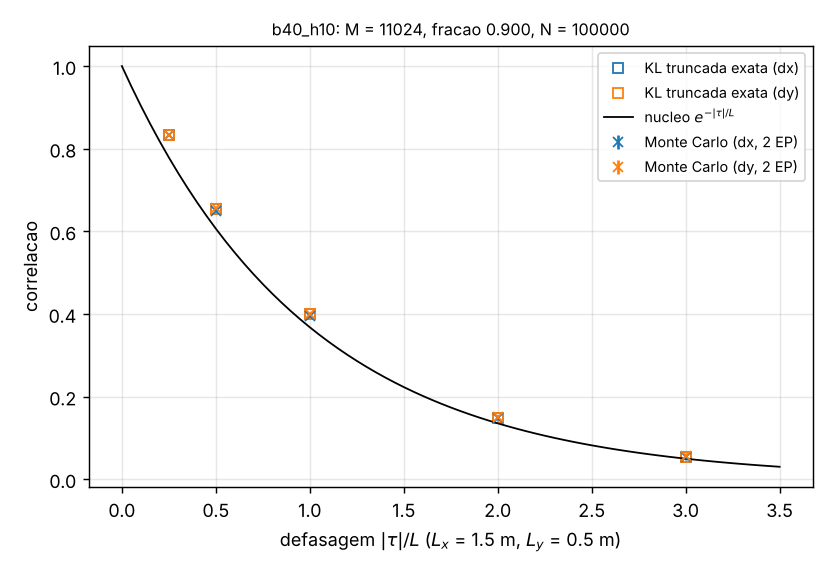
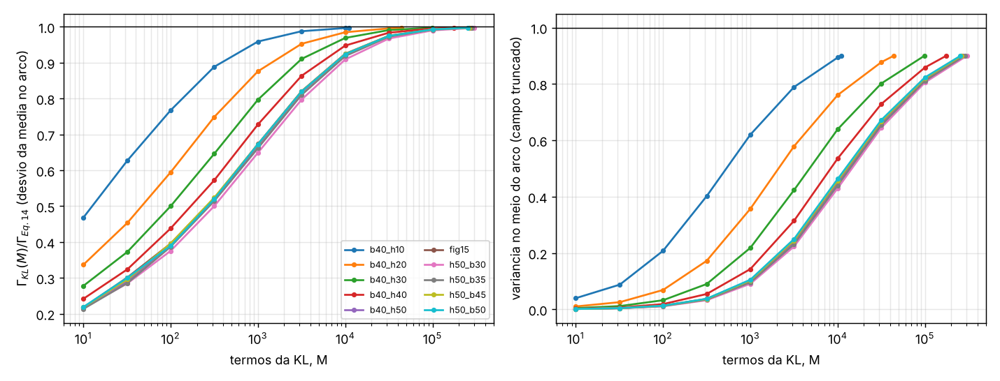
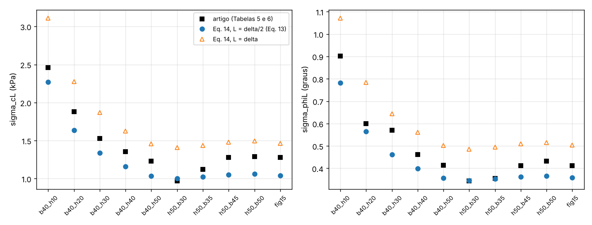

# V6_MediaLocalKL: a média do campo de Karhunen-Loève ao longo de um arco

Referência: Y. Yuan, C. Hu, Y. Mei, X. Wang e J. Wang (2021), *Slope reliability analysis based on curvilinear local
averaging of a 2-D random field*, Computers and Geotechnics 137:104247, doi:10.1016/j.compgeo.2021.104247 (Seções 2
e 3: Eqs. 3 a 15, Fig. 15, Tabelas 2 e 5 a 8).

## O caso

O artigo deriva a variância da média de um campo aleatório 2D estacionário ao longo de um arco circular (a "média
local curvilínea"):

    Var[X_L] = σ²/T² ∫₀ᵀ∫₀ᵀ ρ_L(ξ, η) dξ dη = Γ² σ²                                   (Eq. 3)

com a correlação separável de Markov ρ = exp[−2(|τ₁|/δ₁ + |τ₂|/δ₂)] (Eq. 13), δ₁ = 3 m (horizontal) e δ₂ = 1 m
(vertical), e o arco OA de centro C(a, b) que passa pelo pé O do talude e sai na crista em A = (c, H) (Eqs. 4 a 12,
Figs. 3 a 5). Com as coordenadas da Eq. 12, ρ_L é a Eq. 14; a Eq. 15 é a forma fechada. As Tabelas 5 e 6 dão os
desvios reduzidos σ_cL = Γ σ_c e σ_φL = Γ σ_φ dos taludes da Fig. 9 (β = 40° com H = 10 a 50 m; H = 50 m com β = 30° a
50°), com σ_c = 8,68 kPa e σ_φ = 2,99° (Tabela 2).

Aqui isso vira uma **verificação do gerador de Karhunen-Loève do Comum** (`Comum/KLSeparavel.h`), sem elementos
finitos:

1. **Referência exata**: Γ² pela Eq. 3 com a Eq. 14, integrada por Gauss-Legendre composta nas variáveis
   s = η − ξ, u = (η + ξ)/2 (`arco.h`), com os painéis quebrados nos bicos do integrando.
2. **KL como os drivers a usam**: `klsep::KL2D` no retângulo do domínio do talude (Fig. 9: 1,5H à esquerda do pé, 2,5H
   de crista, fundação de H), como num RFEM, com o número de termos da Eq. 29 (≥ 90% da variância) e o campo truncado
   sem renormalizar (`KL2D::Campo`).
3. **Variância exata do campo truncado**: a média no arco é X_M = Σ √λ_k ξ_k F_k, F_k = (1/T)∫φ_k ds, então
   Var[X_M] = Σ λ_k F_k² = Γ_KL² (sem amostragem). Pelo teorema de Mercer, Γ_KL² cresce com M e tende a Γ².
4. **Monte Carlo**: N realizações com o gerador normal de `KLSeparavel.h`; o desvio amostral da média no arco contra
   Γ_KL e Γ. Em 20 realizações a média é feita também por `KL2D::Campo` nos pontos de quadratura do arco (o caminho
   dos drivers); as amostras grandes usam Σ √λ_k ξ_k F_k, que é a mesma conta reordenada (difere em 10⁻¹⁵).
5. Também: a **variância no ponto** (contra a fração retida), a **correlação amostral** em defasagens de 0,25 a 3 L
   (horizontais, verticais, diagonais e ao longo do arco) contra o núcleo, a **convergência com M** e a normalidade da
   média (assimetria, curtose, cauda de 5%).

**Convenção de δ.** A Eq. 13 é exp(−2|τ|/δ) = exp(−|τ|/L) com L = δ/2: Lx = 1,5 m e Ly = 0,5 m no núcleo do
`KLSeparavel.h`. A Seção 4 do artigo (a KL do RFEM) escreve exp(−c|x₁ − x₂|) com c = 1/δ, o que daria L = δ: uma
ambiguidade de fator 2 do próprio artigo. As Tabelas 5 e 6 (e o "−4r" da Eq. 15) correspondem à Eq. 13, que é a nossa
referência; L = δ fica como sensibilidade (`CONVENCAO=delta`). A diferença é grande: Γ cresce ~40%.

**Erro de sinal na Eq. 15.** A última linha da Eq. 15 tem cos((η+ξ)/2r − θ). Da Eq. 14 (ou da Eq. 12) sai
Δx = 2r sin((η−ξ)/2r) cos((η+ξ)/2r + θ) e Δy = 2r sin((η−ξ)/2r) sin((η+ξ)/2r + θ): o sinal certo é **+θ**.
Integramos a forma correta, conferida contra a Eq. 14 por força bruta; a impressa muda Γ de −3,7% a +3,1% nos nossos
arcos (teste e coluna `Gamma_eq15_impressa`).

**Os arcos.** O artigo não imprime os círculos: eles são ajustados aos nós de maior deformação plástica do SRM do
ABAQUS, e só a Fig. 15 mostra um. Usamos:

- `fig15`: o círculo da Fig. 15, digitalizado (`dados/yuan2021_fig15_circulo.csv`, `scripts/digitaliza_fig15.py`):
  centro (−46,02; 116,06) m, r = 124,85 m, saída na crista em x = 59,92 m. O talude da figura tem H = 50 m e face a
  45° (o caso β = 45° da Tabela 6). O círculo pelos pontos pretos da figura, forçado a passar pelo pé, dá centro
  (−47,3; 112,4) e Γ 0,5% maior;
- os 9 taludes: o **círculo crítico pelo pé de Bishop simplificado** (`bishop.h`), com c = 36,9 kPa e φ = 22,6°
  (Tabela 2) e γ = 18,72 kN/m³, calibrado para FS = 0,9938 no talude H = 50 m, β = 40° (Tabela 7). É uma reconstrução
  nossa; os outros 8 FS ficam como previsões (tabela abaixo).

## Dados

| grandeza | valor usado | fonte / suposição |
|---|---|---|
| σ_c, σ_φ | 8,68 kPa, 2,99° | Tabela 2 (só para converter Γ em σ_cL e σ_φL) |
| δ₁, δ₂ | 3,0 m, 1,0 m | Seção 3.3 (Cassidy et al. 2013) |
| núcleo | exp(−\|Δx\|/Lx − \|Δy\|/Ly), Lx = δ₁/2 = 1,5 m, Ly = δ₂/2 = 0,5 m | Eq. 13; L = δ como sensibilidade (Seção 4) |
| domínio do campo | retângulo da Fig. 9: [−1,5H, H/tan β + 2,5H] × [−H, H] | Fig. 9 (ex.: 259,6 × 100 m para H = 50 m, β = 40°) |
| truncamento da KL | fração retida ≥ 90% (M = 11.024 a 301.040 termos) | Eq. 29; 95% e 99% como sensibilidade |
| taludes | β = 40°, H = 10 a 50 m; H = 50 m, β = 30° a 50° | Tabelas 5 a 8, Fig. 9 |
| arcos | círculo crítico de Bishop pelo pé; círculo da Fig. 15 | **nossa** reconstrução; Fig. 15 digitalizada (aproximado, ±0,2 m) |
| c, φ médios | 36,9 kPa, 22,6° | Tabela 2 (só para a busca do círculo de Bishop) |
| γ | 18,72 kN/m³ | **suposto**: não dado; calibrado no FS = 0,9938 (Tabela 7, H = 50 m, β = 40°) |
| realizações | 2·10⁴ (testes), 5·10³ a 10⁵ (execuções), 10⁵ por caso no cluster | **nossas** (o artigo usa 10⁴ no RFEM) |
| gerador | xoshiro256** + Box-Muller de `KLSeparavel.h`, semente fixa | Comum |

Valores impressos das Tabelas 5 a 8: `dados/yuan2021_tabelas.csv`. Os arcos e o γ afetam só a comparação com as
Tabelas 5 e 6; a verificação do gerador (Monte Carlo contra a Eq. 14 no mesmo arco) não depende deles.

## Compilar e rodar

```bash
cmake --build <build> --target V6_MediaLocalKL V6_testes
cd <pasta de saída>
CASO=tabelas <build>/Projects/V6_MediaLocalKL/V6_MediaLocalKL           # arcos e Eq. 14 dos 10 casos (3 s)
CASO=b40_h10 N=100000 <build>/Projects/V6_MediaLocalKL/V6_MediaLocalKL  # KL + Monte Carlo (40 s)
CASO=fig15 FRACAO=0.95 MKL=900000 N=20000 <build>/Projects/V6_MediaLocalKL/V6_MediaLocalKL
```

Variáveis de ambiente (ver o cabeçalho de `main.cpp`): `CASO` (`b40_h10` … `b40_h50`, `h50_b30` … `h50_b50`, `fig15`,
`tabelas`), `CONVENCAO` (`eq13` ou `delta`), `FRACAO` (0,90), `MKL` (limite de termos, 400.000), `N` (10.000),
`SEMENTE`, `NCONF` (realizações conferidas por `KL2D::Campo`, 20), `DELTA1`, `DELTA2`, `VERBOSE`. Saídas na pasta
corrente:

- `resumo.csv`: uma linha com o arco, M, a fração, Γ (Eq. 14), Γ_KL, a Eq. 15 impressa, a outra convenção, o desvio
  amostral e o seu erro padrão, a variância no meio do arco, assimetria, curtose, σ_cL e σ_φL contra o artigo, tempos;
- `convergencia.csv`: para M = 10, 32, 100, … até o M usado: fração, Γ_KL, Γ_KL/Γ, a variância no meio do arco e a
  correlação normalizada em 1 Lx e 1 Ly;
- `sondas.csv`: as 20 sondas (variância exata do campo truncado, amostral e erro padrão);
- `correlacao.csv`: os 15 pares (defasagem, núcleo, correlação exata do campo truncado, amostral e erro padrão);
- `tabelas.csv` (`CASO=tabelas`): os 10 arcos, FS de Bishop, Γ nas três leituras e as Tabelas 5 a 8;
- `resultado.txt`: uma linha `chave=valor` com `situacao=ok` e `seg=`, gravada por último (um `.tmp` renomeado).

Figuras de várias execuções (uma subpasta cada, `tabelas/` para a comparação com as tabelas):
`python3 scripts/plot_v6.py <pasta> --saida <pasta>`.

No cluster (fermi, SLURM), de dentro de `cluster/`:

```bash
source ../../Cluster/modulos.sh && ./compilar_v6.sh     # no nó de login (cmake)
sbatch v6.sbatch                                        # 17 execuções em 8 núcleos (~1 h)
EXECUCOES="tabelas fig15 b40_h50" TESTES=1 sbatch v6.sbatch
```

`v6.sbatch` roda cada execução da lista na sua pasta em `$SAIDA` (os 10 casos com 10⁵ realizações, as KL de 95% e 99%,
a convenção L = δ e 10⁶ realizações no talude de 10 m), junta os `resumo.csv`, roda os testes (`TESTES=1`) e faz as
figuras. Execuções com `resultado.txt` são puladas (retomável). Memória: ~180 MB (H = 10 m) a ~360 MB (KL de 95% no
talude de 50 m) por execução.

## Testes

`V6_testes` (Catch2, marca `[V6]`; os demorados com `[.lento]`). Tolerâncias estatísticas: 4 erros padrão (semente
fixa).

| teste | compara | tolerância |
|---|---|---|
| geometria do arco | Eqs. 4, 6, 7, 8, 11 e 12 (pontos no círculo, cordas, extremidades, tangente); os 10 arcos no solo e saindo na crista; saída da Fig. 15 em x = 60 m | 10⁻¹²; 0,5 m (leitura) |
| Eq. 14 | segmento reto (raio de 10¹² m) contra a forma fechada de Vanmarcke, 12 combinações de ângulo e comprimento; força bruta (ponto médio n × n com Richardson) em dois arcos; refino da quadratura; a Eq. 15 impressa difere > 1% | 10⁻⁸; 2·10⁻⁵; 10⁻¹⁰ |
| autopares 1D | equação integral ∫e^{−\|s−t\|/L} f(t) dt = λ f(s) e ortonormalidade, 7 modos (até o 400º) em 3 domínios | 10⁻⁹ λ, 10⁻¹⁰ |
| KL truncada (H = 10 m) | M = 11.024 pela Eq. 29; variância exata nas 20 sondas contra a fração; covariância truncada contra o núcleo (limite de Cauchy-Schwarz e 3% em defasagens ≥ 1 L); quadratura de F_k convergida | 0,01; rigoroso; 3%; 10⁻⁸ |
| Monte Carlo (H = 10 m, N = 2·10⁴) | `Campo` = Σ√λξF; variância e média nas sondas; correlação em 15 defasagens contra a KL exata e o núcleo; desvio da média no arco contra Γ_KL e Γ; assimetria, curtose e cauda | 10⁻¹²; 4 EP (+ limite de truncamento contra o núcleo e Γ) |
| convergência com M | Γ_KL(M) crescente e ≤ Γ; Γ_KL/Γ > 0,95 com M = 1000 e > 0,99 a 90%; déficit da média < 15% do déficit no ponto; correlação normalizada em 1 L ≈ e⁻¹/fração | 10⁻⁶; 3% |
| arcos × Tabelas 5 a 8 | γ calibrado; FS de Bishop contra as Tabelas 7 e 8; Γ contra as Tabelas 5 e 6 (faixa que delimita a discrepância documentada, **não** concordância); Fig. 15 contra o círculo de Bishop do mesmo talude | 10⁻⁶; 10%; [0,78; 1,06]; 5% em T, 2% em Γ |
| `[.lento]` H = 50 m, β = 40° | KL de 90% no domínio de 259,6 × 100 m (M = 272.700), 10⁴ realizações: os mesmos testes | 4 EP; Γ_KL/Γ > 0,99 |
| `[.lento]` Fig. 15 | KL de 90% com 10⁴ realizações e KL de 95% (M ≈ 7,5·10⁵): o déficit cai | 4 EP; déficit(95%) < 0,6 déficit(90%) |
| `[.lento]` L = δ | a outra convenção no arco da Fig. 15 (M = 65.838), 10⁴ realizações; Γ = 0,1688 | 4 EP; 1% |

Resultado real (este container, 1 núcleo, Release): os 7 testes padrão passaram (1910 verificações) em 12,6 s; os 3
testes `[.lento]` passaram (194 verificações) em 4 min 1 s, com pico de 362 MB (ctest: 13,5 s para os padrão).

## Artigo × nosso resultado

### 1. O gerador: Monte Carlo contra a Eq. 14 no mesmo arco

KL de 90% (Eq. 29) no domínio inteiro de cada talude; "MC/Eq. 14" é o desvio amostral da média no arco sobre Γ, e
"z" é (dp − Γ_KL)/EP.

| caso | domínio (m) | M | fração | Γ (Eq. 14) | Γ_KL | Γ_KL/Γ − 1 | N | dp amostral ± EP | MC/Eq. 14 − 1 | z | assimetria / excesso de curtose | tempo (s) |
|---|---|---|---|---|---|---|---|---|---|---|---|---|
| b40_h10 | 51,9 × 20 | 11.024 | 0,9000 | 0,26165 | 0,26087 | -0,30% | 100.000 | 0,26095 ± 0,00058 | -0,27% | +0,13 | +0,011 / +0,011 | 37 |
| b40_h20 | 103,8 × 40 | 43.805 | 0,9000 | 0,18873 | 0,18817 | -0,30% | 5.000 | 0,19103 ± 0,00191 | +1,22% | +1,50 | +0,046 / +0,144 | 11 |
| b40_h30 | 155,8 × 60 | 98.345 | 0,9000 | 0,15419 | 0,15381 | -0,24% | 5.000 | 0,15099 ± 0,00151 | -2,07% | -1,87 | -0,060 / -0,079 | 25 |
| b40_h40 | 207,7 × 80 | 174.643 | 0,9000 | 0,13352 | 0,13320 | -0,23% | 5.000 | 0,13278 ± 0,00133 | -0,55% | -0,32 | -0,060 / -0,075 | 46 |
| b40_h50 | 259,6 × 100 | 272.700 | 0,9000 | 0,11942 | 0,11914 | -0,23% | 10.000 | 0,11888 ± 0,00084 | -0,46% | -0,32 | -0,016 / -0,073 | 130 |
| h50_b30 | 286,6 × 100 | 301.040 | 0,9000 | 0,11563 | 0,11530 | -0,28% | 5.000 | 0,11499 ± 0,00115 | -0,56% | -0,27 | +0,011 / -0,072 | 99 |
| h50_b35 | 271,4 × 100 | 285.099 | 0,9000 | 0,11777 | 0,11749 | -0,24% | 5.000 | 0,11710 ± 0,00117 | -0,56% | -0,33 | +0,037 / +0,007 | 85 |
| h50_b45 | 250,0 × 100 | 262.642 | 0,9000 | 0,12101 | 0,12073 | -0,24% | 5.000 | 0,12286 ± 0,00123 | +1,53% | +1,74 | +0,025 / +0,149 | 72 |
| h50_b50 | 242,0 × 100 | 254.203 | 0,9000 | 0,12257 | 0,12227 | -0,24% | 5.000 | 0,12228 ± 0,00122 | -0,24% | +0,00 | -0,021 / +0,085 | 68 |
| fig15 | 250,0 × 100 | 262.642 | 0,9000 | 0,11988 | 0,11960 | -0,23% | 10.000 | 0,11934 ± 0,00084 | -0,45% | -0,31 | -0,017 / -0,038 | 117 |
| fig15_delta (L = δ) | 250,0 × 100 | 65.838 | 0,9000 | 0,16881 | 0,16842 | -0,23% | 10.000 | 0,16812 ± 0,00119 | -0,41% | -0,25 | -0,040 / -0,023 | 27 |

O desvio amostral concorda com Γ_KL dentro do erro de amostragem em todos os casos (|z| ≤ 1,9; a assimetria e o
excesso de curtose ficam dentro de 2 EP, √(15/N) e √(96/N)), e Γ_KL fica 0,23% a 0,30% abaixo de Γ (o efeito exato do
truncamento na média no arco). Com estes N a amostragem não resolve essa diferença de 0,3% (o EP relativo do desvio
é 0,22% com N = 10⁵ e 1% com N = 5·10³): ela vem da conta exata Σλ_k F_k²; as 10⁶ realizações do cluster (EP 0,07%)
a resolveriam.

### 2. Variância no ponto e correlação (talude H = 10 m, M = 11.024, N = 10⁵)

| grandeza | núcleo (exato) | KL truncada (exata) | Monte Carlo | observação |
|---|---|---|---|---|
| variância no ponto (20 sondas) | 1 | 0,9004 (0,9004 a 0,9005) | 0,890 a 0,906 (EP 0,004) | fração retida 0,9000: a variância truncada é uniforme a 10⁻⁴ |
| correlação, Δx = 0,25 / 0,5 / 1 / 2 / 3 Lx | 0,779 / 0,607 / 0,368 / 0,135 / 0,050 | 0,832 / 0,655 / 0,400 / 0,148 / 0,055 | 0,832 / 0,650 / 0,394 / 0,148 / 0,053 (EP 0,001 a 0,003) | a correlação normalizada do campo truncado é ~1/0,9 maior |
| correlação, Δy = 0,25 / 0,5 / 1 / 2 / 3 Ly | idem | 0,832 / 0,655 / 0,400 / 0,148 / 0,055 | 0,833 / 0,656 / 0,399 / 0,150 / 0,056 | idem (o núcleo é o mesmo em unidades de L) |
| covariância em 1 Lx e 1 Ly | 0,3679 | 0,3604 (−2,0%) | 0,354 / 0,359 | a parte que falta é de escala curta |
| correlação ao longo do arco, Δl = 0,5 / 1 / 2 m (Eq. 14) | 0,441 / 0,190 / 0,033 | 0,485 / 0,213 / 0,037 | 0,485 / 0,209 / 0,037 | ρ_L do artigo no meio do arco |



### 3. Convergência com o número de termos

| M | fração retida, H = 10 m | Γ_KL/Γ, H = 10 m | variância no meio do arco, H = 10 m | fração retida, H = 50 m | Γ_KL/Γ, H = 50 m |
|---|---|---|---|---|---|
| 10 | 0,027 | 0,4679 | 0,0398 | 0,001 | 0,2167 |
| 32 | 0,079 | 0,6274 | 0,0880 | 0,004 | 0,2908 |
| 100 | 0,198 | 0,7673 | 0,2080 | 0,011 | 0,3938 |
| 316 | 0,398 | 0,8886 | 0,4020 | 0,034 | 0,5196 |
| 1.000 | 0,618 | 0,9590 | 0,6203 | 0,098 | 0,6690 |
| 3.162 | 0,788 | 0,9878 | 0,7893 | 0,237 | 0,8172 |
| 10.000 | 0,894 | 0,9967 | 0,8941 | 0,448 | 0,9230 |
| 11.024 | 0,900 | 0,9970 | 0,9004 | — | — |
| 31.623 | — | — | — | 0,661 | 0,9743 |
| 100.000 | — | — | — | 0,816 | 0,9926 |
| 272.700 | — | — | — | 0,900 | 0,9977 |

A média no arco converge muito mais depressa que a variância no ponto: com 62% da variância retida o desvio da média
já está a 4% de Γ; com 90% (Eq. 29), a 0,3%. O déficit de variância da média (1 − Γ_KL²/Γ², 0,6%) é 6% do déficit no
ponto (10%). No arco da Fig. 15 (domínio de 250 × 100 m), a KL de 95% (M = 749.894, 13 s, 353 MB) deixa o desvio da
média a 0,066% de Γ (déficit de variância 0,13%, contra 0,46% com 90%).



### 4. Os arcos reconstruídos contra as Tabelas 5 a 8

| caso | arco | centro (m) | r (m) | T (m) | FS Bishop | FS artigo | Γ | σ_cL (kPa) | artigo | dif. | σ_φL (°) | artigo | dif. | Γ (L = δ) | Eq. 15 impressa / Eq. 14 |
|---|---|---|---|---|---|---|---|---|---|---|---|---|---|---|---|
| b40_h10 | bishop | (2,07; 14,82) | 14,97 | 20,68 | 2,1354 | 2,2100 | 0,2617 | 2,271 | 2,460 | -7,7% | 0,782 | 0,901 | -13,2% | 0,3586 | 1,0312 |
| b40_h20 | bishop | (0,97; 31,57) | 31,58 | 38,74 | 1,4578 | 1,5460 | 0,1887 | 1,638 | 1,880 | -12,9% | 0,564 | 0,599 | -5,8% | 0,2621 | 1,0058 |
| b40_h30 | bishop | (-1,74; 49,71) | 49,75 | 56,13 | 1,2108 | 1,3000 | 0,1542 | 1,338 | 1,530 | -12,5% | 0,461 | 0,571 | -19,3% | 0,2156 | 0,9941 |
| b40_h40 | bishop | (-5,55; 68,73) | 68,96 | 73,13 | 1,0782 | 1,1670 | 0,1335 | 1,159 | 1,356 | -14,5% | 0,399 | 0,462 | -13,6% | 0,1873 | 0,9872 |
| b40_h50 | bishop | (-10,20; 88,42) | 89,00 | 89,86 | 0,9938 | 0,9938 | 0,1194 | 1,037 | 1,230 | -15,7% | 0,357 | 0,413 | -13,5% | 0,1679 | 0,9827 |
| h50_b30 | bishop | (4,79; 109,60) | 109,71 | 114,11 | 1,2629 | 1,3180 | 0,1156 | 1,004 | 0,971 | +3,4% | 0,346 | 0,344 | +0,5% | 0,1625 | 1,0077 |
| h50_b35 | bishop | (-3,27; 97,13) | 97,19 | 100,18 | 1,1124 | 1,1910 | 0,1178 | 1,022 | 1,120 | -8,7% | 0,352 | 0,355 | -0,8% | 0,1654 | 0,9945 |
| h50_b45 | bishop | (-16,47; 81,84) | 83,48 | 81,88 | 0,8965 | 0,8752 | 0,1210 | 1,050 | 1,280 | -17,9% | 0,362 | 0,412 | -12,2% | 0,1702 | 0,9723 |
| h50_b50 | bishop | (-22,39; 76,61) | 79,81 | 75,55 | 0,8139 | 0,8023 | 0,1226 | 1,064 | 1,290 | -17,5% | 0,366 | 0,432 | -15,2% | 0,1725 | 0,9633 |
| fig15 | fig15 | (-46,02; 116,06) | 124,85 | 79,37 | 0,9362 | 0,8752 | 0,1199 | 1,041 | 1,280 | -18,7% | 0,358 | 0,412 | -13,0% | 0,1688 | 0,9647 |



## Discussão

**O gerador está verificado.** No mesmo arco, o desvio amostral da média concorda com o desvio exato do campo truncado
(Σλ_k F_k²) dentro do erro de amostragem em todos os casos, de 11 mil a 272 mil termos; a média é a mesma por
`KL2D::Campo` nos pontos do arco; a média no arco é normal (assimetria, curtose e cauda de 5% dentro de 4 EP); os
autopares 1D satisfazem a equação integral a 10⁻⁹. E o desvio exato do campo truncado converge monotonamente para a
Eq. 14 (teorema de Mercer), ficando 0,2% a 0,3% abaixo dela com a regra de 90% da Eq. 29. Isso confirma, ao mesmo
tempo, a convenção L = δ/2 do núcleo para reproduzir a Eq. 13, o domínio e a interpolação do campo.

**Truncamento: o que se perde é o ponto, não a média.** Com 90% retidos, a variância no ponto é 0,900 em todo lugar
(uniforme a 10⁻⁴), mas a covariância em defasagens ≥ 1 L perde só ~2% e a variância da média no arco 0,6%. Como os
drivers usam o campo truncado sem renormalizar, um RFEM com a Eq. 29 tem 10% a menos de variância no ponto, mas
praticamente a mesma variância das médias ao longo das superfícies de ruptura: para a probabilidade de ruptura de um
talude o truncamento a 90% é quase irrelevante. Se o campo fosse renormalizado pela variância local (dividido por
√0,9), a covariância em 1 L passaria de 0,360 para 0,400 (o núcleo dá 0,368) e a variância da média no arco ficaria
~10% acima da Eq. 14: renormalizar seria pior.

**Convenção de δ.** A leitura L = δ (a da Seção 4 do artigo) dá Γ ~40% maior (ex.: 0,1688 contra 0,1199 no arco da
Fig. 15). Para quem usa o `KLSeparavel.h` com valores de δ da literatura (escala de flutuação), Lx = δ/2.

**As Tabelas 5 e 6 não são reproduzidas.** Com os nossos arcos, o nosso Γ fica abaixo das tabelas em 18 dos 20
valores, até −19% (σ_cL e σ_φL); as menores diferenças são em β = 30° (+3,4% e +0,5%) e β = 35° (−8,7% e −0,8%).
Com o círculo do próprio artigo
(Fig. 15, β = 45°), σ_cL = 1,04 kPa contra 1,28 kPa (−19%) e σ_φL = 0,358° contra 0,412° (−13%). Não é o arco: o
nosso círculo de Bishop para o mesmo talude tem raio bem diferente (83 m contra 125 m) mas comprimento (82 contra 79 m)
e Γ (0,1210 contra 0,1199) quase iguais; Γ depende sobretudo do comprimento e da orientação do arco. Não há leitura
simples que reproduza as tabelas (razões nosso/artigo de Γ_c e Γ_φ, com os nossos arcos): L = δ dá +14% a +45%;
trocar δ₁ e δ₂ dá −15% a −29%; δ isotrópico de 3 m dá +5% a +28% (`CASO=tabelas` com `CONVENCAO`, `DELTA1`, `DELTA2`).
Indícios de que as tabelas têm erro numérico próprio:

- para o mesmo arco o fator de redução não depende de σ, mas as tabelas dão Γ_c = σ_cL/σ_c e Γ_φ = σ_φL/σ_φ que
  diferem até 9% (H = 30 m: 0,176 contra 0,191; β = 35°: 0,129 contra 0,119);
- a Eq. 20 usa, para H = 50 m e β = 40°, variâncias 1,323 e 0,158 (Γ = 0,1325 e 0,1329, consistentes entre si), e não
  os valores da Tabela 5 (0,1417 e 0,1381); o nosso Γ para esse talude é 0,1194 (−10% contra a Eq. 20);
- a Eq. 15 impressa tem o erro de sinal (ela daria valores ainda menores, −3,5% no arco da Fig. 15);
- a tendência com β é muito mais forte nas tabelas (Γ_c de 0,112 a 0,149 entre β = 30° e 50°) que na Eq. 14 com os
  nossos arcos (0,116 a 0,123).

**FS de Bishop contra o SRM do artigo.** Com γ calibrado num caso, os outros 8 FS de Bishop ficam de −7,6% a +2,4% dos
das Tabelas 7 e 8, dentro da dispersão interna do próprio artigo (os FS das Tabelas 7 e 8 e os implícitos nas curvas
de estado limite das Tabelas 3 e 4 diferem até ~10%). O círculo da Fig. 15 não é crítico para Bishop (FS 0,936 contra
0,897 do nosso círculo crítico).

## Pendências

- As execuções com 10⁵ realizações por caso, as KL de 95% e 99% nos taludes de 50 m e de 10 m e as 10⁶ realizações no
  talude de 10 m (que resolveriam a diferença de 0,3% entre Γ_KL e Γ por amostragem) ficaram para o cluster
  (`cluster/v6.sbatch`); aqui rodaram 5·10³ a 10⁵ realizações por caso.
- Os arcos das Tabelas 5 e 6 são reconstruções (Bishop); um círculo ajustado à banda de deformação do nosso SRM
  (o procedimento do artigo) exigiria rodar o SRM do V2 nesses taludes secos.
- O Monte Carlo do RFEM do artigo (Tabela 9) não faz parte desta verificação.
