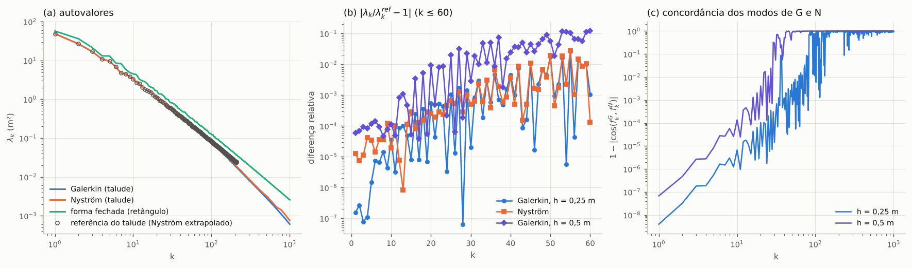
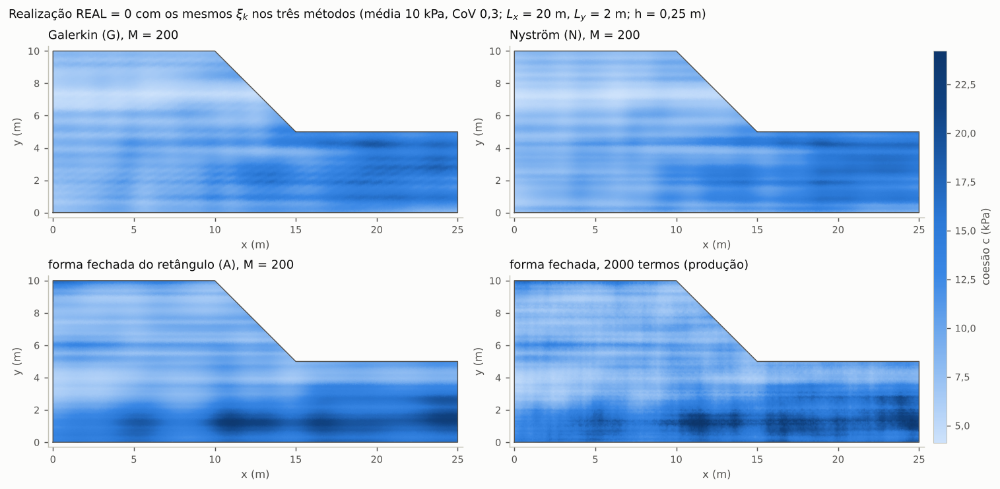
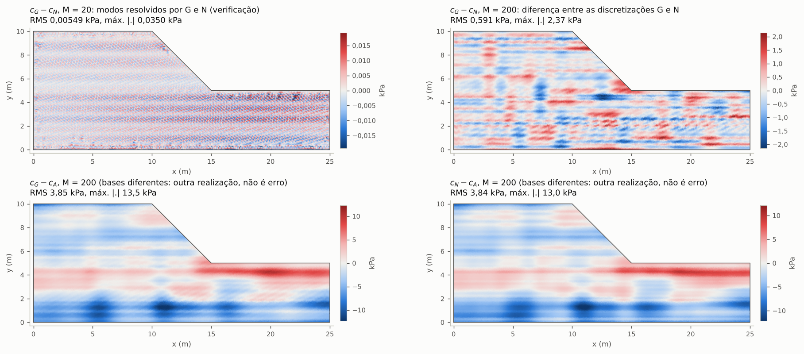
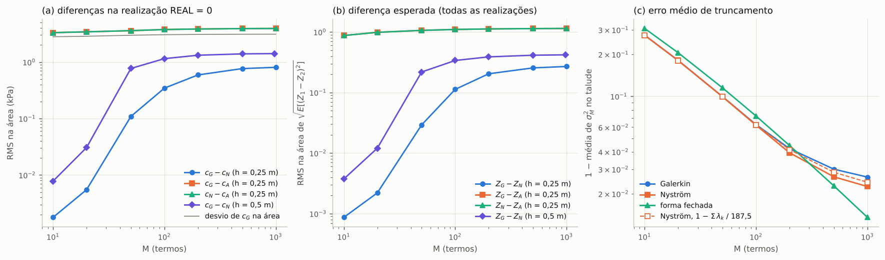
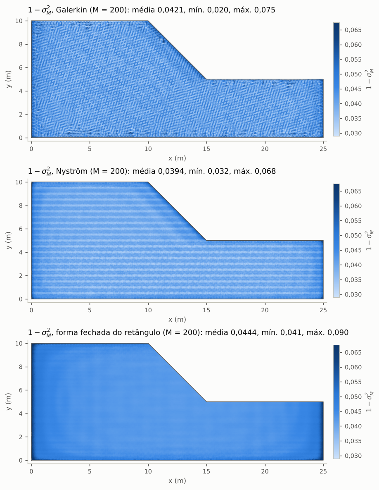
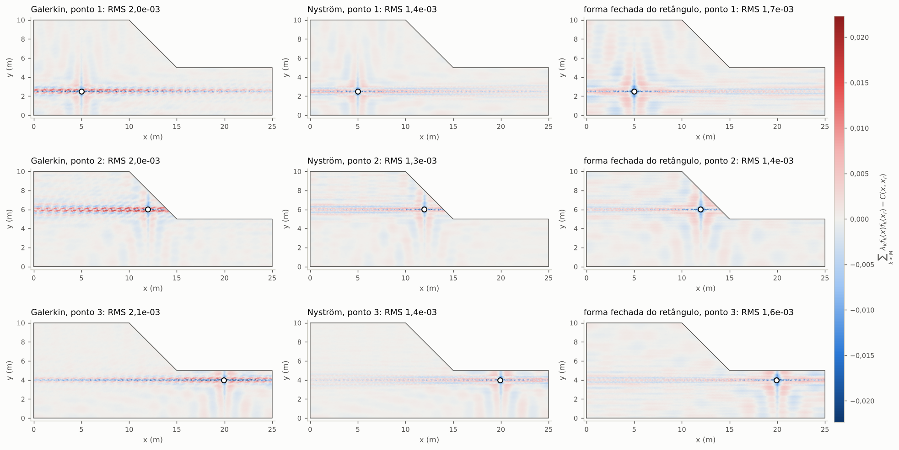
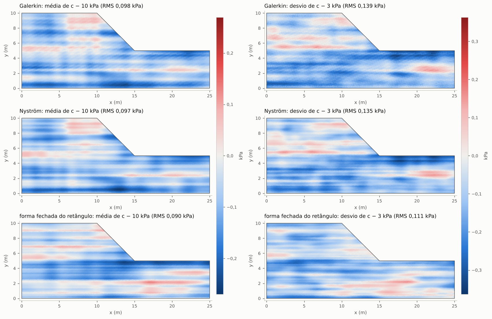

# VerifyRandomFields: o campo de coesão do talude por Galerkin, forma fechada e Nyström, com os mesmos números aleatórios

O programa `VerifyRandomFields` (`main.cpp`) gera o campo aleatório de coesão c' do talude de Vargas Ceron, Cecílio,
Linn e Maghous (2025, Seção 6) de três formas, com a **mesma sequência de números aleatórios**, percorre **todos os
pontos de integração** de uma malha uniforme fina do talude e compara, em cada ponto, a coesão das três formas. Os
campos de erro saem em VTK escritos pelo NeoPZ (`TPZVTKGeoMesh::PrintGMeshVTK`) para abrir no ParaView.

- **G** — Karhunen-Loève (KL) de Galerkin do NeoPZ no próprio talude (`TPZKarhunenLoeveMat`, o esquema de
  `../KLCilindroMika/talude.cpp`), na malha uniforme fina;
- **A** — forma fechada (solução analítica) do retângulo [0,25] × [0,10] que contém o talude, a mesma do
  `SlopeRandomField` (`../SlopeRandomField/KLSeparavel.h`), com M termos e com os 2000 termos de produção;
- **N** — Nyström no talude, independente da malha de Galerkin.

Campo: núcleo exponencial separável C(x, x') = exp(−|x − x'| / Lx − |y − y'| / Ly), Lx = 20 m, Ly = 2 m (Vargas Ceron
et al. 2025, eq. 64); coesão lognormal com média 10 kPa e CoV 0,3. Talude (0,0) (25,0) (25,5) (15,5) (10,10) (0,10),
área 187,5 m².

## Resumo dos resultados (malha h = 0,25 m, M = 200 termos, realização REAL = 0)

- G e N concordam ponto a ponto quando os mesmos ξ_k multiplicam os mesmos modos: com M = 10 e 20 termos, a diferença
  c_G − c_N é de 0,0018 e 0,0055 kPa (RMS na área; máximo de 0,035 kPa com M = 20), contra um desvio do campo de
  2,8 kPa. O campo dessa diferença com M = 20 sai nos VTK (`dGN_M20`) e na figura das diferenças. Com M = 200 ela é de
  0,59 kPa (correlação dos campos 0,98): a partir de k ≈ 25 a 40, os modos têm escala vertical próxima da resolução das
  duas discretizações, e os pares de modos quase degenerados se misturam. Essa diferença mede a resolução das duas
  discretizações, e não o erro de uma delas. Na malha h = 0,5 m, com o mesmo Nyström, a diferença com M = 200 é de
  1,32 kPa e cai para 0,59 kPa em h = 0,25 m.
- A forma fechada usa outra base (as autofunções do retângulo, não as do talude). Com os mesmos ξ_k ela dá **outra
  realização** de um campo com a mesma covariância: c_G − c_A tem RMS de 3,85 kPa, do tamanho da própria flutuação
  (correlação dos campos 0,49). Essa diferença não é erro.
- As estatísticas nos pontos concordam nas três formas:
  - variância truncada σ_M² com 200 termos: déficit médio de 0,042 em G, 0,039 em N e 0,044 em A, contra 0,0375 da KL
    exata do talude. Pelos autovalores, 1 − Σλ_k / 187,5 dá 0,042 em G e 0,041 em N. Os modos de Nyström interpolados
    acima de k ≈ 100 não têm norma 1 nos pontos e somam 0,002 à variância de N;
  - covariância com três pontos de referência: erro RMS de 1,3e-3 a 2,1e-3;
  - Monte Carlo com 1000 realizações (os mesmos ξ nas três formas): a média e o desvio de c em cada ponto ficam a 0,075
    a 0,096 kPa (RMS na área) dos valores esperados com a variância truncada. É o ruído amostral de 1000 realizações
    (cerca de 0,09 kPa).
- Duas verificações independentes, com scripts próprios em Python e uma revisão do código, reproduziram os autovalores,
  os campos e as estatísticas até a precisão impressa (seção [Verificação](#verificação)).

## O que se pode comparar

O campo truncado é Z(x) = Σ_{k<M} √λ_k ξ_k f_k(x), com (λ_k, f_k) os autopares do núcleo **no domínio onde a KL é
feita**, e c = exp(μ_ln + σ_ln Z). Os mesmos ξ_k em bases diferentes não dão a mesma realização:

- **G e N** resolvem o mesmo problema de autovalores (o do talude). Com os mesmos ξ_k e os sinais dos modos alinhados, as
  duas realizações coincidem ponto a ponto nos modos bem resolvidos. A diferença c_G − c_N mede as duas discretizações
  (malha de elementos finitos contra quadratura) e a mistura de modos quase degenerados, cujos autovetores dependem da
  discretização (uma rotação dentro do par não muda a estatística, mas muda a realização).
- **A** usa as autofunções do retângulo [0,25] × [0,10] (produtos de cossenos e senos), que não são as do talude. Com os
  mesmos ξ_k, Z_A é outra realização de um campo cuja covariância no talude é a mesma, a menos do truncamento. A diferença
  c_G − c_A não é erro: é a diferença entre duas realizações de mesma estatística, correlacionadas porque os primeiros
  modos do retângulo e do talude se parecem. Para dois campos independentes de mesma variância, E[(Z₁ − Z₂)²] = 2; aqui
  E[(Z_G − Z_A)²] = 1,26 (média na área), e a correlação de Z_G e Z_A no mesmo ponto é de 0,34 em média (de 0,02 a
  0,70).
- As comparações que valem para os três são estatísticas em cada ponto: a variância truncada σ_M²(x) = Σ_{k<M} λ_k
  f_k(x)² (alvo 1), a covariância Σ_{k<M} λ_k f_k(x) f_k(x_r) com pontos de referência contra o núcleo C(x, x_r), e a
  média e o desvio de c em Monte Carlo contra 10 kPa e 3 kPa (e contra os alvos lognormais com a variância truncada).

## As três formulações

**Núcleo e coesão.** C(x, x') = exp(−|x − x'| / Lx − |y − y'| / Ly) com variância 1. Coesão lognormal
(`klsep::Lognormal`): c = exp(μ_ln + σ_ln Z), σ_ln² = ln(1 + CoV²), μ_ln = ln(média) − σ_ln² / 2. Com a variância
truncada σ_M²(x), a média e o desvio exatos de c no ponto são E_M[c] = exp(μ_ln + σ_ln² σ_M² / 2) e
DP_M[c] = E_M[c] √(exp(σ_ln² σ_M²) − 1).

**G — Galerkin (NeoPZ).** Os modos f = Σ v_j N_j (funções H1 contínuas de ordem `ORDEM_P`) resolvem C v = λ B v, com
B_ij = ∫ N_i N_j (`CalcStiffB`, a regra do elemento) e C_ij = ∫∫ N_i(x) C(x, x') N_j(x') (`TPZKarhunenLoeveMat::ContributeC`
em todos os pares de elementos, com a regra de ordem `ORDEM` nos dois elementos; `TPZKarhunenLoeveMat` do tipo 3). Pelo
Cholesky B = L Lᵀ, os autopares são os de L⁻¹ C L⁻ᵀ; os modos são B-ortonormais (∫ f_k² = 1 no talude).

**A — forma fechada do retângulo.** `klsep::KL2D` na caixa dos nós da malha, [0,25] × [0,10]: os autopares 2D são os
produtos dos autopares 1D do núcleo exponencial (raízes de ω tan(ωa) = c e ω + c tan(ωa) = 0), e os M termos são os M
maiores produtos λ_i^x λ_j^y. É a expansão do `SlopeRandomField` (com `KL_M = 2000` na produção); os primeiros M termos da
expansão de 2000 termos são os da expansão de M termos (o programa confere).

**N — Nyström.** Independente da malha de Galerkin: o talude é dividido no retângulo de baixo [0,25] × [0,5] e no
trapézio de cima {5 ≤ y ≤ 10, 0 ≤ x ≤ 20 − y}, este mapeado por x = s (20 − y), s ∈ [0,1] (jacobiano 20 − y). Cada parte
tem células de cerca de `NYS_CELULA` (50 × 10 no retângulo, 30 × 10 em s × y no trapézio, com 0,5 m) e `NYS_Q` × `NYS_Q`
pontos de Gauss-Legendre por célula (7200 nós com 0,5 m e 3 × 3). Os autopares são os da matriz simétrica W^½ K W^½,
f_k(x_j) = v_jk / √w_j, e fora dos nós os modos vêm da interpolação de Nyström
f_k(x) = (1/λ_k) Σ_j w_j C(x, x_j) f_k(x_j).

O núcleo tem uma dobra em y = y' (e outra em x = x'). Com Ly = 2 m, a regra de Gauss não integra a dobra em y, e os
autovalores ficam O(h²) acima dos exatos: cerca de 1e-2 relativo do modo 10 em diante com células de 0,5 m (tabela
abaixo). Por isso, com `NYS_PRODUTO=1` (padrão), o fator em y dos pares de nós da mesma linha de células — as células que
a dobra y = y' atravessa — é integrado exatamente (integração-produto): os nós de Gauss de uma linha de células têm as
mesmas ordenadas, e a integral dupla G_ab = ∫∫ l_a(y) exp(−|y − y'| / Ly) l_b(y') dy dy' na célula (l_a os polinômios de
Lagrange nos pontos de Gauss) é calculada uma vez. A matriz continua simétrica. Na interpolação, o mesmo fator usa a
integral exata ∫ exp(−|y − y'| / Ly) l_b(y') dy' no ponto (a extensão de Nyström da representação polinomial em y da
linha de células). A dobra em x (Lx = 20 m) fica com a regra de Gauss. `NYS_PRODUTO=0` dá o Nyström de Gauss-Legendre
puro.

**Mesmos números aleatórios.** Na realização REAL, ξ = `klsep::Normal(SEMENTE · 0x9E3779B97F4A7C15 + 3 · REAL + 0)`,
a sequência da coesão do `SlopeRandomField` (o mesmo gerador xoshiro256** com Box-Muller e a mesma semente). Os M
primeiros valores multiplicam os M primeiros modos de G, de N e de A; A2000 usa os 2000 primeiros. O campo A2000 do
programa é o do `SlopeRandomField` nos mesmos pontos (conferido contra `klsep::KL2D::Campo`: diferença máxima de 2,1e-14
em Z na malha h = 0,25 m e de 2,4e-14 em h = 0,5 m).

**Sinais.** O sinal de um autovetor é arbitrário. Cada modo de Galerkin recebe o sinal que torna ∫ f_k p > 0, com o peso
fixo p(x, y) = exp((x − 12,5) / 10 + (y − 5) / 4), positivo e sem simetria. Cada modo de Nyström recebe o sinal de
⟨f_k^G, f_k^N⟩ nos pontos de integração. A forma fechada tem os sinais fixos dos cossenos e senos; G e A não são
alinhados (são bases diferentes). A regra é determinista, mas não garante o mesmo sinal entre malhas ou valores de
`ORDEM` nos modos com |∫ f_k p| pequeno. O menor |∫ f_k p| / ‖p‖ nos 1000 modos é 1,2e-7 (9,7e-9 em h = 0,5 m), e
44 dos 200 primeiros modos têm |∫ f_k p| / ‖p‖ < 1e-3, 4 deles abaixo de 1e-4 (71 e 6 em h = 0,5 m). Isso não afeta
as comparações: o programa só compara ponto a ponto G e N da mesma corrida (N alinhado a G), e as estatísticas não
dependem dos sinais. Realizações c_G de malhas diferentes não devem ser comparadas ponto a ponto.

**Autopares.** Os dois problemas são densos (3647 equações em G, 7200 nós em N). O programa calcula todos os autovalores e
só os 1000 primeiros autovetores: tridiagonalização de Householder do Eigen, QR implícito sem vetores na tridiagonal,
iteração inversa na tridiagonal (fatoração LU com pivoteamento parcial, como `dlagtf`/`dlagts` do LAPACK) e as reflexões
de Householder de volta. Custo 4/3 n³ + 2 n² · 1000, contra cerca de 9 n³ do `SelfAdjointEigenSolver` com todos os
vetores. O Nyström roda numa thread enquanto a KL de Galerkin é montada e resolvida.

**Reprodutibilidade.** Na montagem de C, a thread t monta as linhas de elementos e1 = t, t + `THREADS`, t + 2 `THREADS`,
... (distribuição fixa), e as parcelas das threads são somadas sempre na mesma ordem. Com o mesmo `THREADS`, duas
corridas dão arquivos iguais bit a bit, a menos dos tempos em `resumo.txt` (conferido nas duas malhas). Com outro
`THREADS`, só o arredondamento muda (cerca de 1e-15 relativo em C).

## Malha

`malhas/talude_uniforme_h025.geo` (padrão) e `malhas/talude_uniforme_h05.geo`: o mesmo polígono e os mesmos grupos
físicos de `../LearningMohrCoulomb2/cluster/malhas/ceron_h5_a45.geo` ("Solo", "Base", "Direita", "Superficie",
"Esquerda"), com tamanho de elemento constante (`Mesh.MeshSizeMin = Mesh.MeshSizeMax = h`, sem tamanho pelos pontos ou
pela curvatura, algoritmo 6, elementos lineares, formato 4.1). As malhas foram geradas pelo módulo gmsh do Python
(4.15.2, uma thread; a geração é reprodutível, byte a byte) com `python3 malhas/gera_malhas.py`.

| malha | h | nós | triângulos | aresta mín. / média / máx. (m) | pontos de integração (3 por triângulo) |
|---|---|---|---|---|---|
| `talude_uniforme_h025.msh` | 0,25 m | 3647 | 7023 | 0,169 / 0,249 / 0,333 | 21069 |
| `talude_uniforme_h05.msh` | 0,5 m | 975 | 1813 | 0,359 / 0,489 / 0,596 | 5439 |

Os pontos de comparação são os pontos de integração de cada elemento computacional da malha de Galerkin, com a regra do
próprio elemento (`GetIntegrationRule()`, a do material para a ordem do elemento: ordem 2, 3 pontos no triângulo P1).
Peso = w |det J|; a soma dos pesos é 187,5 a menos de 4e-11.

## Compilar e rodar

O projeto entra no build do NeoPZ com `BUILD_PROJECTS=ON` e precisa do Eigen3 (≥ 3.3); sem ele o projeto fica de fora e os
outros configuram normalmente. No build do SlopeRandomField:

```bash
cd ../SlopeRandomField
./compilar.sh                                           # biblioteca e SlopeRandomField (uma vez)
cmake --build build --target VerifyRandomFields -j 4
B=build/Projects/VerifyRandomFields/VerifyRandomFields
SAIDA=saida_h025 $B                                     # malha h = 0,25 m, padrões (2,5 min, 1,3 GB)
MALHA=talude_uniforme_h05.msh SAIDA=saida_h05 $B        # malha h = 0,5 m (2 min; o Nyström domina)
M=20 SAIDA=saida_M20 $B                                 # comparação principal com 20 termos
SO_AUTOVALORES=1 ORDEM=10 SAIDA=ordem10 $B              # só os autovalores (escolha de ORDEM e NYS_*)
python3 ../VerifyRandomFields/plota.py saida_h025 saida_h05   # figuras em ../VerifyRandomFields/figuras
```

A malha padrão é lida de `malhas/` deste diretório (caminho gravado na compilação); `MALHA` sem '/' também é procurada
ali. A malha deve ser o talude acima (o programa confere a caixa dos nós e a área), porque o Nyström usa a geometria.

| variável | padrão | |
|---|---|---|
| `MALHA` | `malhas/talude_uniforme_h025.msh` | malha do Gmsh 4.1 com os grupos físicos acima |
| `LX`, `LY` | 20, 2 | comprimentos de correlação (m) |
| `MEDIA`, `COV` | 10, 0.3 | média (kPa) e coeficiente de variação da coesão |
| `ORDEM_P` | 1 | ordem dos elementos de Galerkin (1 a 3) |
| `ORDEM` | 6 | ordem da regra do triângulo nas integrais duplas de C, em todos os pares (12 pontos; 0: a do elemento, 2P) |
| `M` | 200 | termos da comparação principal (os três métodos) |
| `M_VERIF` | 20 | termos dos campos extras c_G − c_N (`dGN_M<m>`; aceita lista, por exemplo `20,30`): um truncamento em que os modos de G e N concordam (modos 1-20 com acordo ≥ 0,99 nas duas malhas) |
| `MS` | `10,20,50,100,200,500,1000` | termos da varredura (limitados pelos modos de G e N: 975 na malha h = 0,5 m) |
| `SEMENTE`, `REAL` | 20250416, 0 | semente e realização dos mapas (as do `SlopeRandomField`) |
| `R` | 1000 | realizações de Monte Carlo (REAL = 0..R−1, os mesmos ξ nos três métodos); 0: sem Monte Carlo |
| `REFS` | `5:2.5,12:6,20:4` | pontos de referência da covariância (`x:y,x:y,...`) |
| `THREADS` | 4 | threads (montagem de C, produtos de matrizes, interpolação de Nyström); com o mesmo valor, as saídas se repetem bit a bit |
| `NYS_CELULA`, `NYS_Q` | 0.5, 3 | tamanho das células (m) e pontos de Gauss por direção no Nyström |
| `NYS_PRODUTO` | 1 | 1: integração-produto da dobra em y na linha de células; 0: Gauss-Legendre puro |
| `SAIDA` | `saida_<malha>` | diretório das saídas (criado se preciso) |
| `VTK` | 1 | 0: sem os arquivos VTK |
| `SO_AUTOVALORES` | 0 | 1: só os autovalores de G e N (λ1..20 na tela; `autovalores.csv`) |
| `VALIDAR` | 0 | 1: confere o solver dos maiores autopares contra o `SelfAdjointEigenSolver` completo do Eigen |

## Saídas

Em `SAIDA`:

- `resumo.txt`: tudo o que o programa mostra na tela (parâmetros, tempos, conferências, tabelas).
- `pontos.csv`: uma linha por ponto de integração: `elemento` (índice do elemento geométrico), `ponto` (índice na regra),
  `x`, `y`, `peso`; `zG`, `zN`, `zA`, `zA2000` (Z normal padrão) e `cG`, `cN`, `cA`, `cA2000` (coesão, kPa) na realização
  REAL; `dGN` = cG − cN, `dGA` = cG − cA, `dNA` = cN − cA, `dGA2000` = cG − cA2000; `s2G`, `s2N`, `s2A`, `s2A2000` (σ_M²);
  `ezGN`, `ezGA`, `ezNA` (√E[(Z₁ − Z₂)²] sobre as realizações, exato); `cov<r>_G`, `cov<r>_N`, `cov<r>_A`, `cov<r>_alvo`
  (covariância com o ponto de referência r e o núcleo); `mcm*` e `mcd*` (média e desvio de c no Monte Carlo); `alvo_m*`
  e `alvo_d*` (E_M[c] e DP_M[c] com a variância truncada de cada método); `mc_rms_dGN`, `mc_rms_dGA`, `mc_rms_dNA`
  (√E[(c₁ − c₂)²] no Monte Carlo); para cada m de `M_VERIF`, `zG_M<m>`, `zN_M<m>` e `dGN_M<m>` (os campos com m termos).
  `x`, `y`, `peso` e os campos Z têm 17 algarismos significativos (o `double` exato, para conferências de fora); os
  demais, 9.
- `modos.csv`: para k = 1..1000: `lambda_G`, `lambda_N`, `lambda_A` (forma fechada do retângulo), `dif_rel_NG`,
  `acordo` = |⟨f_k^G, f_k^N⟩| / (‖f_k^G‖ ‖f_k^N‖) nos pontos de integração, `melhor_j` e `cos_melhor` (o modo de Nyström
  mais parecido com f_k^G), `subespaco3` (norma da projeção de f_k^G nos modos de Nyström k−3..k+3), `norma_N` e
  `sinal_G` (|∫ f_k p| / ‖p‖).
- `varredura.csv`: para cada M de `MS`: RMS (na área) e máximo de |c_G − c_N|, |c_G − c_A|, |c_N − c_A| na realização
  REAL, correlação dos campos, √E[(Z₁ − Z₂)²] médio na área, 1 − média de σ_M² de cada método, o desvio de c_G e
  1 − Σ_{k<M} λ_k / 187,5 de G e de N (`erro_var_lambda_G`, `erro_var_lambda_N`).
- VTK (ver a seção do ParaView): `campos_pontos.vtk`, `campos_elementos.vtk` e `campos_elementos_<campo>.vtk`.

`resultados/` tem os `resumo.txt`, `modos.csv` e `varredura.csv` das duas malhas, os quatro campos de erro da realização
na malha h = 0,25 m (`campos_elementos_dGN_M20.vtk`, `campos_elementos_dGN.vtk`, `campos_elementos_dGA.vtk`,
`campos_elementos_dNA.vtk`) e as tabelas das escolhas de `ORDEM` e do Nyström (`escolhas/ordem_galerkin.csv` e
`escolhas/nystrom.csv`: λ1..20 de cada configuração e a referência). Os arquivos grandes (`pontos.csv`, 15 MB;
`campos_pontos.vtk`, 9,5 MB; os outros VTK) são refeitos pelo programa em 2,5 min.

## Resultados

Máquina de 4 núcleos; montagem de C, produtos de matrizes e interpolação com 4 threads; o Nyström numa thread, em paralelo
com Galerkin.

### Escolha da regra de C (`ORDEM`) e do Nyström

λ_k de Galerkin P1 contra a referência do talude (Nyström extrapolado de `../SlopeRandomFieldRefina`, incerteza ≤ 4e-7
nos 20 primeiros modos):

| malha | ORDEM (pontos) | C (s) | λ1 | λ5 | λ10 | λ20 | máx. 1-20 | Σ todos / 187,5 |
|---|---|---|---|---|---|---|---|---|
| h = 0,5 m | 2 (3) | 0,1 | +4,4e-4 | +1,3e-3 | +4,3e-3 | +1,2e-2 | 1,2e-2 | 0,9593 |
| h = 0,5 m | 4 (6) | 0,4 | +2,5e-4 | +6,6e-4 | +1,8e-3 | −3,5e-3 | 3,5e-3 | 0,9539 |
| h = 0,5 m | 6 (12) | 0,8 | +5,9e-5 | +1,2e-4 | −1,1e-4 | −9,4e-3 | 9,4e-3 | 0,9524 |
| h = 0,5 m | 10 (25) | 3,3 | +2,9e-5 | +3,2e-5 | −4,2e-4 | −1,0e-2 | 1,0e-2 | 0,9521 |
| h = 0,25 m | 2 (3) | 2,0 | +1,8e-6 | +2,1e-5 | +5,5e-5 | +4,2e-5 | 8,1e-5 | 0,9784 |
| h = 0,25 m | 4 (6) | 4,4 | +9,1e-7 | +7,5e-6 | −8,7e-6 | −4,6e-4 | 4,6e-4 | 0,9758 |
| h = 0,25 m | 6 (12) | 12,5 | +1,5e-7 | −1,5e-6 | −3,7e-5 | −5,6e-4 | 5,6e-4 | 0,9755 |
| h = 0,25 m | 10 (25) | 48,1 | +5,1e-8 | −2,5e-6 | −4,0e-5 | −5,7e-4 | 5,7e-4 | 0,9754 |

- Entre ORDEM 6 e 10, na malha h = 0,25 m, os 20 primeiros autovalores mudam no máximo 1,3e-5 (3,6e-6 nos 10
  primeiros); entre 4 e 6, 1,0e-4; entre 2 e 4, 5,0e-4. ORDEM = 6 é o padrão: a quadratura fica abaixo do erro da malha,
  com 1/4 do custo de ORDEM 10.
- A regra do elemento (ordem 2) põe os autovalores acima dos de Galerkin com integração exata (a dobra do núcleo); na
  malha h = 0,25 m esse erro compensa em parte o da malha (os de Galerkin com integração exata ficam abaixo dos exatos) e
  os 20 primeiros ficam a menos de 8,1e-5 da referência, por acaso.
- Com ORDEM 6, λ1..20 ficam a menos de 5,6e-4 da referência (λ1: 1,5e-7). O erro que sobra é o da malha P1 e cresce
  com k (λ20: −5,6e-4 em h = 0,25 m e −9,4e-3 em h = 0,5 m).

Nyström (o mesmo em todas as malhas), autovalores contra a mesma referência (tridiagonalização numa thread):

| célula (m) | pontos por célula | integração-produto em y | nós | tridiagonalização (s) | λ1 | λ5 | λ10 | λ20 | máx. 1-10 | máx. 1-20 | Σ todos / 187,5 |
|---|---|---|---|---|---|---|---|---|---|---|---|
| 1 | 3 × 3 | sim | 1800 | 1 | +5,1e-5 | +1,3e-4 | −3,3e-4 | −1,5e-2 | 4,3e-4 | 1,5e-2 | 0,9572 |
| 0,5 | 2 × 2 | sim | 3200 | 5 | +2,2e-5 | −4,7e-5 | −1,1e-3 | −1,2e-2 | 1,1e-3 | 1,2e-2 | 0,9667 |
| 0,5 | 3 × 3 | não | 7200 | 110 | +9,5e-4 | +3,1e-3 | +1,0e-2 | +3,6e-2 | 1,0e-2 | 3,6e-2 | 1,0000 |
| **0,5** | **3 × 3** | **sim (padrão)** | **7200** | **116** | **+1,3e-5** | **+3,4e-5** | **+2,0e-5** | **−2,5e-4** | **1,2e-4** | **2,9e-4** | **0,9786** |
| 0,25 | 2 × 2 | sim | 12800 | 758 | +6,0e-6 | +9,5e-6 | −6,5e-5 | −8,6e-4 | 6,5e-5 | 8,6e-4 | 0,9833 |

- Sem a integração-produto, a dobra do núcleo em y põe todos os autovalores acima dos exatos, com um erro que cresce com
  k (1,0e-2 em λ10 e 3,6e-2 em λ20 com o padrão de células). Ela também deixa a interpolação de Nyström com um erro que
  oscila na escala das células (o erro da regra de Gauss em ∫ C(x, x') dx' muda com a posição de x na célula). Com a
  integração-produto, o mesmo número de nós dá λ1..20 a menos de 2,9e-4 da referência.
- Com 2 × 2 pontos (polinômios lineares em y na célula), os modos com variação vertical rápida (λ20) pioram mesmo com
  células de 0,25 m e 12800 nós (6,5 vezes o tempo). O padrão é 0,5 m e 3 × 3: os 10 primeiros autovalores a 1,2e-4 e os
  20 primeiros a 2,9e-4, em 2 min numa thread, enquanto a KL de Galerkin é montada.
- A soma de todos os autovalores é o traço da matriz: a área (1,0000 × 187,5) no Gauss-Legendre puro; com a
  integração-produto, a diagonal da linha de células fica com a integral exata (menor que a regra de Gauss).

### Autovalores

Malha h = 0,25 m, ORDEM 6; Nyström com células de 0,5 m, 3 × 3 pontos e integração-produto em y:

| k | λ_G | λ_N | referência | (λ_G − ref) / ref | (λ_N − ref) / ref | λ_A (retângulo) |
|---|---|---|---|---|---|---|
| 1 | 48,810009 | 48,810617 | 48,810002 | 1,5e-7 | 1,3e-5 | 57,154776 |
| 2 | 26,730071 | 26,730260 | 26,730064 | 2,7e-7 | 7,3e-6 | 36,231368 |
| 3 | 16,911422 | 16,911614 | 16,911423 | −7,8e-8 | 1,1e-5 | 21,400327 |
| 4 | 10,824468 | 10,824930 | 10,824469 | −1,1e-7 | 4,3e-5 | 13,120322 |
| 5 | 9,571596 | 9,571936 | 9,571610 | −1,5e-6 | 3,4e-5 | 13,046415 |
| 10 | 3,349024 | 3,349212 | 3,349147 | −3,7e-5 | 2,0e-5 | 4,511364 |
| 15 | 1,709116 | 1,709613 | 1,709129 | −8,0e-6 | 2,8e-4 | 2,553985 |
| 20 | 1,104244 | 1,104579 | 1,104859 | −5,6e-4 | −2,5e-4 | 1,674077 |
| 30 | 0,594397 | 0,594716 | 0,594409 | −2,0e-5 | 5,2e-4 | 0,816628 |
| 50 | 0,252473 | 0,251822 | 0,256862 | −1,7e-2 | −2,0e-2 | 0,382133 |

- G e N concordam entre si a menos de 1,3e-4 nos 10 primeiros autovalores e de 3,0e-4 nos 20 primeiros; os dois ficam a
  menos de 5,6e-4 da referência nos 20 primeiros.
- De k ≈ 25 em diante, parte dos modos (os de variação vertical rápida) fica abaixo da referência **nas duas** formas.
  A resolução das duas é parecida: arestas de 0,25 m em G e três pontos por 0,5 m em N.
  - Em k = 25 a 40, esses modos ficam até 0,5% (G) e 0,7% (N) abaixo (G: −1,7e-3 em k = 27, −3,0e-3 em k = 32,
    −4,7e-3 em k = 36); em k = 41 a 60, até 2,7% e 2,9%.
  - Até k = 60, os demais modos ficam a menos de 1e-3 (G) e 2,3e-3 (N) da referência.
  - Acima de k ≈ 60, todos ficam abaixo, e o desvio cresce com k. Medianas de G / N: −2,1% / −2,0% em k = 61 a 80,
    −4,8% / −3,5% em 80 a 100, −12% / −10% em 101 a 150 e −21% / −16% em 150 a 200 (−24% / −19% em k = 200).

  Por isso G e N concordam entre si (2,6e-3 até k = 50) melhor do que com a referência nesses modos. Pelos autovalores,
  o déficit de variância com 200 termos é 0,0421 (G) e 0,0414 (N), contra 0,0375 da KL exata.
- A referência tem incerteza relativa (a diferença entre duas extrapolações de Richardson) de até 4e-7 em k ≤ 20,
  1,3e-3 em k ≤ 50, 1,3e-2 em k ≤ 100 e 2,8e-2 em k ≤ 200. Entre k = 21 e 210, só os desvios de G em k = 44, 46, 54, 56,
  60 e 76 e os de N em k = 51, 60 e 76 ficam dentro dela (não são resolvidos). Todos os outros ficam acima, inclusive
  todos os citados acima; em k ≥ 80, os de G têm pelo menos 2,7 vezes a incerteza e os de N, 1,8 vez.
- A forma fechada é a do retângulo: λ1 = 57,15 contra 48,81 no talude. Σ λ_k / área dá a fração de variância: com 200
  termos, 0,9579 (G) e 0,9586 (N) no talude; 0,9625 na KL exata do talude.
- Conferências do solver: max ‖A v − λ v‖ / λ1 = 3,2e-15 (G) e 4,7e-15 (N); max |VᵀV − I| = 2,3e-14 e 1,0e-13. Contra o
  `SelfAdjointEigenSolver` completo (`VALIDAR=1`): autovalores a menos de 7e-16 λ1 e vetores com
  1 − |⟨v, v_ref⟩| ≤ 1e-14.



### Concordância dos modos

|⟨f_k^G, f_k^N⟩| / (‖f_k^G‖ ‖f_k^N‖) nos pontos de integração (21069 em h = 0,25 m, 5439 em h = 0,5 m; modos de
Nyström com o sinal alinhado):

| | h = 0,25 m | h = 0,5 m |
|---|---|---|
| primeiro k com acordo < 0,999 | 34 | 16 |
| primeiro k com acordo < 0,99 | 36 | 22 |
| primeiro k com acordo < 0,9 | 83 | 29 |
| modos 1-50 com acordo ≥ 0,99 | 48 | 24 |
| modos 1-100 com acordo ≥ 0,99 | 72 | 24 |
| modos 1-200 com acordo ≥ 0,99 | 77 | 24 |

- Até k = 50 (malha h = 0,25 m), o modo de Nyström mais parecido com f_k^G é sempre o de mesmo índice, e a projeção de
  f_k^G no subespaço dos modos de Nyström k−3..k+3 tem norma de pelo menos 0,995. As quedas do acordo nessa faixa são
  rotações dentro de pares quase degenerados: os modos 36 e 37 (autovalores a 0,57% um do outro) têm acordo 0,914 e
  0,913, mas 1,000 e 0,998 no subespaço dos vizinhos.
- Até k = 100, 86 dos 100 modos têm o melhor par no mesmo índice (83 com pelo menos 0,99 no subespaço dos vizinhos);
  entre 51 e 100, 36 dos 50 (33). Acima de ~100, as duas discretizações não resolvem os mesmos modos (com 200 termos, 105
  dos 200 têm o melhor par no mesmo índice).
- Com a malha h = 0,5 m e o mesmo Nyström, o acordo cai bem antes (k = 16 e 22), o que mostra que a diferença vem da
  discretização de Galerkin.

### A realização REAL = 0

Coesão em kPa nos pontos de integração da malha h = 0,25 m, M = 200 (A2000: os 2000 termos de produção), estatísticas
ponderadas pela área:

| campo | média | desvio | mínimo | máximo |
|---|---|---|---|---|
| c_G | 10,098 | 3,083 | 4,13 | 19,30 |
| c_N | 10,098 | 3,082 | 4,00 | 19,00 |
| c_A | 11,483 | 3,906 | 5,53 | 23,44 |
| c_A2000 | 11,506 | 3,976 | 5,00 | 26,69 |

| diferença | RMS (kPa) | máx. \|.\| (kPa) | correlação dos campos | √E[(Z₁ − Z₂)²] (exato) | √E[(c₁ − c₂)²] (Monte Carlo, kPa) |
|---|---|---|---|---|---|
| c_G − c_N | 0,591 | 2,37 | 0,982 | 0,204 | 0,619 |
| c_G − c_A | 3,850 | 13,45 | 0,492 | 1,120 | 3,355 |
| c_N − c_A | 3,842 | 13,05 | 0,495 | 1,122 | 3,359 |
| c_G − c_A2000 | 3,927 | 15,63 | 0,484 | | |

As duas últimas colunas são médias na área sobre todas as realizações: √E[(Z₁ − Z₂)²] = (Σ_{k<M} (√λ_k^1 f_k^1(x) −
√λ_k^2 f_k^2(x))²)^½ é exato (os ξ_k são independentes); a da coesão sai do Monte Carlo com 1000 realizações. A
realização REAL = 0 tem diferenças da ordem dessas médias (c_G − c_N: 0,59 contra 0,62 kPa; c_G − c_A: 3,85 contra
3,36 kPa).

**G contra N com M = 20 (`M_VERIF`).** Nos modos 1 a 20, G e N concordam: o acordo é de pelo menos 0,9998 em
h = 0,25 m e 0,9959 em h = 0,5 m. Com esses 20 termos:

| malha | RMS de c_G − c_N (kPa) | máx. \|c_G − c_N\| (kPa) | correlação dos campos | √E[(Z_G − Z_N)²] (exato, RMS na área) |
|---|---|---|---|---|
| h = 0,25 m | 0,0055 | 0,035 | 0,999998 | 0,0022 |
| h = 0,5 m | 0,031 | 0,125 | 0,99994 | 0,012 |

É a verificação ponto a ponto de G contra N (campo `dGN_M20` nos VTK). O mapa (primeiro painel da figura abaixo) tem a
textura dos elementos: é o erro de interpolação P1 de G, que cai 5,6 vezes de h = 0,5 para 0,25 m. Com M = 200 (segundo
painel), a diferença é dominada pelos modos que nenhuma das duas discretizações resolve: é a diferença entre as
discretizações, e não o erro de uma delas. Os dois painéis de baixo (c_G − c_A e c_N − c_A) comparam bases diferentes:
são outras realizações, não erros.





### Varredura em M

RMS na área de c_G − c_N e c_G − c_A na realização REAL = 0 (kPa), √E[(Z_G − Z_N)²] médio na área (exato) e o déficit
médio de variância 1 − média de σ_M² de cada forma:

| M | c_G − c_N, h = 0,25 m | c_G − c_N, h = 0,5 m | c_G − c_A | √E[dZ²] G−N, h = 0,25 m | √E[dZ²] G−N, h = 0,5 m | 1 − σ²: G | N | A | desvio de c_G |
|---|---|---|---|---|---|---|---|---|---|
| 10 | 0,0018 | 0,0078 | 3,31 | 0,0009 | 0,0037 | 0,274 | 0,274 | 0,307 | 2,81 |
| 20 | 0,0055 | 0,031 | 3,42 | 0,0022 | 0,012 | 0,181 | 0,181 | 0,205 | 2,86 |
| 50 | 0,109 | 0,770 | 3,59 | 0,029 | 0,218 | 0,0995 | 0,0994 | 0,115 | 2,98 |
| 100 | 0,345 | 1,148 | 3,76 | 0,113 | 0,338 | 0,0627 | 0,0620 | 0,0722 | 3,05 |
| 200 | 0,591 | 1,319 | 3,85 | 0,204 | 0,388 | 0,0421 | 0,0394 | 0,0444 | 3,08 |
| 500 | 0,765 | 1,394 | 3,91 | 0,255 | 0,413 | 0,0300 | 0,0264 | 0,0228 | 3,11 |
| 1000 | 0,806 | 1,410 (975) | 3,93 | 0,269 | 0,419 (975) | 0,0263 | 0,0225 | 0,0135 | 3,11 |

- G e N: a diferença é desprezível com poucos termos (0,0018 kPa com M = 10, h = 0,25 m) e cai com h² da malha de
  Galerkin (de h = 0,5 para 0,25 m: 4,3 vezes com M = 10 e 5,6 vezes com M = 20). Ela cresce com M porque os termos
  altos não são resolvidos da mesma forma pelas duas discretizações, e para de crescer quando os λ_k ficam pequenos (de
  M = 500 para 1000, 0,77 → 0,81 kPa).
- G e A: a diferença é do tamanho da flutuação desde M = 10 (3,3 kPa, contra um desvio de 2,8 kPa); não diminui com M,
  porque as bases são diferentes.
- O déficit de variância da forma fechada continua a cair com M (0,0135 com 1000 termos e 0,008 com 2000); o de G e de N
  para no erro da discretização (0,026 e 0,023 com M = 1000). Pelos autovalores, 1 − Σλ_k / 187,5, o de N é 0,0414,
  0,0285 e 0,0242 com M = 200, 500 e 1000 (linha tracejada da figura). É mais do que o déficit nos pontos (0,0394, 0,0264
  e 0,0225) porque os modos de Nyström interpolados acima de k ≈ 100 têm normas de 0,97 a 1,26 nos pontos. Em G, as duas
  contas coincidem.



### Variância truncada, covariância e Monte Carlo

Variância truncada σ_M², M = 200 (alvo 1). A última coluna é o déficit pelos autovalores, 1 − Σ_{k<M} λ_k / área, com a
área do talude (187,5 m²) em G e N e a do retângulo (250 m²) em A:

| forma | 1 − média nos pontos | σ_M² mín. | σ_M² máx. | 1 − Σ_{k<M} λ_k / área |
|---|---|---|---|---|
| G, h = 0,25 m | 0,0421 | 0,925 | 0,980 | 0,0421 |
| G, h = 0,5 m | 0,0565 | 0,905 | 0,982 | 0,0565 |
| N | 0,0394 | 0,932 | 0,968 | 0,0414 |
| A | 0,0444 | 0,910 | 0,959 | 0,0444 (retângulo) |
| A2000 | 0,0080 | 0,987 | 0,992 | 0,0080 (retângulo) |
| KL exata do talude (referência) | 0,0375 | | | 0,0375 |

A média de σ_M² na área é Σ_k λ_k ‖f_k‖² / 187,5, com as normas nos pontos de integração.

- Em G, as duas colunas coincidem: os modos são B-ortonormais e a regra do elemento integra P1 × P1 exatamente
  (max |FᵀWF − I| = 1,5e-14 com 200 modos, W os pesos dos pontos).
- Em N, os modos interpolados nos pontos só são ortonormais a menos do erro da interpolação: max |FᵀWF − I| = 5,8e-4 com
  20 modos e 0,59 com 200. As normas ficam entre 0,996 e 1,037 até k = 100 e entre 0,97 e 1,26 de k = 101 a 200 (a
  pior em k = 178). Elas somam Σ_k λ_k (‖f_k‖² − 1) / 187,5 = 0,0021 à variância de N nos pontos (0,0020 na malha
  h = 0,5 m). Por isso o déficit de N nos pontos (0,0394) parece mais próximo do exato (0,0375) do que os seus
  autovalores justificam (0,0414).
- Os alvos E_M[c] e DP_M[c] de N usam o mesmo σ_M² dos pontos, e a comparação de N com o Monte Carlo continua
  consistente.

O déficit de G tem a textura da malha (σ_M² de um campo P1 varia dentro do elemento); o de N tem faixas horizontais nas
linhas de células de 0,5 m; o de A cresce junto às laterais x = 0 e x = 25 do retângulo, onde a expansão truncada converge
mais devagar.



Covariância truncada com três pontos de referência contra o núcleo, M = 200: RMS na área / máximo de
|Σ_{k<M} λ_k f_k(x) f_k(x_r) − C(x, x_r)|:

| ponto | G, h = 0,25 m | G, h = 0,5 m | N | A |
|---|---|---|---|---|
| (5; 2,5) | 2,0e-3 / 3,1e-2 | 5,1e-3 / 4,4e-2 | 1,4e-3 / 3,1e-2 | 1,7e-3 / 3,9e-2 |
| (12; 6) | 2,0e-3 / 2,1e-2 | 5,0e-3 / 6,5e-2 | 1,3e-3 / 2,6e-2 | 1,4e-3 / 3,3e-2 |
| (20; 4) | 2,1e-3 / 4,3e-2 | 6,4e-3 / 7,8e-2 | 1,4e-3 / 2,9e-2 | 1,6e-3 / 3,7e-2 |

O erro se concentra nas linhas x = x_r e y = y_r, onde o núcleo tem a dobra que a soma truncada não reproduz.



Monte Carlo com R = 1000 realizações (REAL = 0..999; os mesmos ξ nas três formas), M = 200 (A2000: 2000): RMS na área e
máximo, em kPa, dos erros da média e do desvio de c em cada ponto. O ruído amostral esperado é de 0,095 kPa na média
(3 / √1000) e de cerca de 0,09 kPa no desvio.

| forma | média − 10 | média − E_M[c] | desvio − 3 | desvio − DP_M[c] |
|---|---|---|---|---|
| G | 0,098 / 0,25 | 0,084 / 0,24 | 0,139 / 0,36 | 0,095 / 0,28 |
| N | 0,097 / 0,27 | 0,084 / 0,26 | 0,135 / 0,36 | 0,096 / 0,28 |
| A | 0,090 / 0,26 | 0,079 / 0,24 | 0,111 / 0,29 | 0,075 / 0,24 |
| A2000 | 0,083 / 0,26 | 0,081 / 0,25 | 0,081 / 0,27 | 0,079 / 0,28 |

- Contra os alvos com a variância truncada (E_M[c] e DP_M[c] de cada forma em cada ponto), os erros são o ruído amostral
  nas quatro formas. Contra 3 kPa, o desvio de G e de N tem também o viés do truncamento (DP_M[c] ≈ 2,93 kPa com
  σ_M² ≈ 0,96). O desvio − 3 de N (0,135 kPa) é um pouco menor que o de G (0,139 kPa) em parte porque a variância de N
  nos pontos tem os 0,002 a mais das normas dos modos altos (ver a variância truncada).
- Os mapas de G e de N são quase iguais (os mesmos ξ nos mesmos modos: o ruído amostral é o mesmo); o de A é outro.
- Média na área da média de Monte Carlo: 9,924 (G), 9,925 (N), 9,942 (A), 9,958 (A2000) kPa, contra E_M[c] ≈ 9,98. O
  desvio da média na área de uma realização é de 1,46 kPa (exato para G com M = 200, pela integral dupla de
  E_M[c(x)] E_M[c(x')] (exp(σ_ln² ρ(x, x')) − 1)): os primeiros modos, com Lx = 20 m, movem o talude todo. O da média de
  1000 realizações é 0,046 kPa, e a diferença de G (−0,058 kPa) é de 1,25 desvio. G, N e A a têm juntos porque usam os
  mesmos ξ.



## Arquivos VTK (ParaView)

Em `SAIDA`, com os campos nos pontos de integração da malha de Galerkin:

- `campos_pontos.vtk`: nuvem dos pontos de integração (células `VTK_VERTEX`) com todos os campos como dados de ponto
  (`cG`, `cN`, `cA`, `cA2000`, `dGN`, `dGA`, `dNA`, `dGA2000`, `dGN_M20` = c_G − c_N com `M_VERIF` termos,
  `erro_var_G/N/A` = σ_M² − 1, `ezGN/GA/NA`, `erro_cov<r>_G/N/A`, `erro_mc_media_G/N/A` = média de Monte Carlo − 10,
  `erro_mc_desvio_G/N/A` = desvio − 3, `mc_rms_dGN/GA/NA`).
- `campos_elementos.vtk`: a malha do talude (triângulos) com a média de cada campo no elemento (Σ w f / Σ w nos pontos do
  elemento) como dados de célula, todos num arquivo, e o índice do elemento (`elemento`).
- `campos_elementos_<campo>.vtk`: um arquivo por campo principal (`cG`, `cN`, `cA`, `cA2000`, `dGN`, `dGN_M20`, `dGA`,
  `dNA`, `dGA2000`, `erro_var_*`, `erro_mc_media_*`, `erro_mc_desvio_*`: 18 arquivos), escrito pelo NeoPZ com
  `TPZVTKGeoMesh::PrintGMeshVTK(gmesh, arquivo, elData)`: o valor de cada triângulo fica no campo `ElData` (e `Material`,
  `Dimension`, `elIndex`); os elementos de contorno ficam de fora (valor −999).

No ParaView: File → Open, escolha o arquivo e Apply. Para a nuvem de pontos, em Representation use *Points* (ou
*Point Gaussian*, com raio de cerca de 0,05) e escolha o campo em Coloring. Para os arquivos de elemento, use *Surface* e
o campo (`ElData` nos arquivos do NeoPZ). Para os erros, um mapa de cores divergente centrado em zero (Rescale to Custom
Range simétrico; por exemplo *Cool to Warm*). Os arquivos foram conferidos com o `meshio`: número de pontos e de células, e
os valores contra `pontos.csv` (diferença do tamanho da precisão impressa: 8 algarismos nos campos dos arquivos do
programa, 6 nos do NeoPZ; as coordenadas têm 17).

## Conferências

O programa confere, a cada corrida (`resumo.txt`):

- Soma dos pesos dos pontos de integração: 187,5 a menos de 4,2e-11 (arredondamento da soma sequencial).
- Solver dos maiores autopares: resíduos e ortogonalidade acima; contra o `SelfAdjointEigenSolver` completo (`VALIDAR=1`,
  malha h = 0,5 m e Nyström com células de 1 m, com e sem a integração-produto): autovalores a menos de 6,9e-16 λ1 e
  vetores com 1 − |⟨v, v_ref⟩| ≤ 8,4e-15, em G e em N.
- Ortonormalidade dos modos nos pontos de integração, max |FᵀWF − I|: G 8,9e-16 (20 modos) e 1,5e-14 (200 modos); N
  5,8e-4 e 0,59 (ver a variância truncada). As normas ‖f_k^N‖ e o termo Σ_k λ_k (‖f_k‖² − 1) / 187,5 saem no resumo.
- Forma fechada: o campo A2000 calculado pela matriz de modos é o de `klsep::KL2D::Campo` (o cálculo do
  `SlopeRandomField`) a 2,1e-14 na malha h = 0,25 m (2,4e-14 em h = 0,5 m); os primeiros M termos da expansão de 2000
  termos são os da expansão de M termos.
- Interpolação de Nyström: com `NYS_PRODUTO=0` (Gauss-Legendre puro), a interpolação de Nyström nos próprios nós
  reproduz os valores nodais a 4,4e-14 (modos 1-20) e 4,2e-12 (modos 1-200) do máximo de cada modo. Com a
  integração-produto, a interpolação aplica a integral exata em y à representação polinomial da linha de células (a
  extensão de Nyström) e difere dos valores nodais pelo erro dessa representação: 2,2e-3 nos modos 1-20 com células de
  0,5 m (3,0e-2 com 1 m); nos modos altos, de escala vertical próxima de 0,5 m, a diferença chega a 0,5 do máximo do modo
  (é a faixa em que G e N deixam de concordar).

Fora do programa:

- Autovalores de G e N contra a referência independente do talude (Nyström extrapolado de `../SlopeRandomFieldRefina`):
  tabela acima.
- Arquivos VTK: lidos pelo `meshio` e conferidos contra `pontos.csv`.
- Soma exata dos pesos impressos em `pontos.csv` (`math.fsum` sobre os 17 algarismos): 187,5 − 1,1e-12.
- Reprodutibilidade: duas corridas com os mesmos parâmetros dão os mesmos arquivos byte a byte, a menos dos tempos em
  `resumo.txt` (conferido com `cmp` nas duas malhas, com `NYS_CELULA=1` para encurtar as corridas).

## Verificação

Os resultados passaram por duas verificações independentes do programa: uma numérica, com scripts próprios em
Python/numpy que não usam o código C++, e uma revisão do código. As duas foram feitas sobre as saídas das malhas
h = 0,25 m e h = 0,5 m anteriores às correções abaixo. As saídas atuais diferem daquelas só no arredondamento de G
(λ_G a 6e-12 relativo; os resultados de N são iguais bit a bit) e nos campos e colunas acrescentados. A forma fechada
nas coordenadas de 17 algarismos, as colunas novas e os arquivos novos foram conferidos de novo.

**O que foi reproduzido de forma independente:**

- **Pontos de integração.** 21069 = 7023 × 3 pontos (5439 = 1813 × 3 em h = 0,5 m). Em cada triângulo, as coordenadas
  baricêntricas são permutações de (1/6, 1/6, 2/3), a regra de ordem 2 do NeoPZ, e o peso é a área / 3. Nenhum ponto
  fica fora do talude, e a soma das áreas exatas dos triângulos do `.msh` é 187,5. Os modos de Galerkin recalculados
  pelas coordenadas baricêntricas coincidem com os das funções de forma do NeoPZ a 2e-14.
- **Números aleatórios e forma fechada.** Um gerador próprio (xoshiro256** + splitmix64 + Box-Muller, em numpy)
  reproduz `klsep::Normal` bit a bit (REAL = 0, 1 e 999). A forma fechada recalculada em Python dá Z_A e Z_A2000 nas
  coordenadas de `pontos.csv` a 1,4e-14 e 3,4e-14. A transformação lognormal (σ_ln² = ln 1,09) e os alvos E_M[c] e
  DP_M[c] conferem a 1e-8. De ponta a ponta, o `SlopeRandomField` (`SO_CAMPOS=1`, REAL = 0) na malha h = 0,5 m dá, nos
  mesmos 5439 pontos, a coesão c_A2000 deste programa a 5e-7 relativo (a precisão impressa pelo `SlopeRandomField`).
- **Galerkin.** Uma montagem P1 própria (massa exata; C com a regra de Dunavant de 12 pontos em todos os pares, a de
  `ORDEM = 6`) dá os autovalores do programa a 1e-11 (k ≤ 1000) nas duas malhas. Com uma regra de grau 9 (Gauss
  colapsado 5 × 5), os autovalores mudam no máximo 9e-6 até k = 50, bem abaixo do erro da malha P1 (5,6e-4 em k = 20).
  A regra dos sinais, Z_G, σ_M², as covariâncias e a varredura G-A coincidem até a precisão impressa. A
  B-ortonormalidade nos pontos é exata a menos de arredondamento (3,5e-14 com 1000 modos).
- **Nyström.** A transcrição em numpy do esquema descrito acima reproduz λ_N a 4e-12, o acordo dos modos, a
  interpolação e a varredura G-N inteira. Um Nyström independente (regra do trapézio numa grade uniforme com nós nas
  dobras do núcleo, n = 20 e 40, extrapolação de Richardson) confirma ponto a ponto os campos de G e de N com poucos
  termos: diferença RMS de 0,0016 / 0,0015 kPa com M = 5, 0,0033 / 0,0027 com M = 10 e 0,012 / 0,010 com M = 20 (contra
  G / N). Acima de k ≈ 25 a regra do trapézio não tem precisão para julgar. Nessa faixa, a extrapolação h² dos
  autovalores de Galerkin (h = 0,5 → 0,25 m) fica a 0,1% a 0,35% da referência em k = 30 a 55, o que confirma que G e N
  estão abaixo dela nesses modos.
- **Estatísticas e tabelas.** O Monte Carlo (R = 1000, os mesmos ξ), refeito com o gerador próprio, reproduz a média e
  o desvio de c em todos os pontos (5e-8). Os números de `resumo.txt` e as tabelas deste README foram refeitos a partir
  de `pontos.csv`, `modos.csv` e `varredura.csv`. A leitura dos mesmos ξ em bases diferentes também confere:
  E[(Z_G − Z_A)²] médio na área é 1,26 (2 para campos independentes), e a correlação de Z_G e Z_A no mesmo ponto vai de
  0,02 a 0,70 (média 0,34).
- **Código.** Sem avisos de `main.cpp` com `-Wall -Wextra`. Foram conferidos a montagem de B e de C, a redução de
  Cholesky, os sinais e o alinhamento de N, o laço de Monte Carlo (sem condição de corrida; variância sem viés) e os
  arquivos VTK (lidos pelo `meshio` e por um leitor próprio). Uma corrida na malha h = 0,5 m com R = 50 repetiu o
  resumo, a menos das linhas de Monte Carlo.

**Corrigido depois das verificações:**

- `pontos.csv` passou a ter `x`, `y`, `peso` e os campos Z com 17 algarismos. Antes, com 9, a conferência de fora ficava
  limitada a 5e-8 em Z_A.
- O resumo, `varredura.csv`, a tabela de variância e a figura da varredura passaram a mostrar o déficit pelos autovalores
  e a ortonormalidade dos modos nos pontos (a variância de N nos pontos inclui as normas dos modos interpolados).
- O campo c_G − c_N com `M_VERIF` = 20 termos (`dGN_M20`), em que G e N resolvem os mesmos modos, entrou nos CSV, nos
  VTK (inclusive um arquivo do NeoPZ) e na figura das diferenças.
- A montagem de C ficou determinista (distribuição fixa das linhas entre as threads); antes, duas corridas diferiam no
  arredondamento.
- Os erros fatais não chamam mais `std::exit` com a thread do Nyström rodando.
- Ajustes de texto: os desvios dos autovalores por faixa de k, as contagens de modos, a incerteza da referência e o
  desvio da média na área (1,46 kPa).

**Em aberto:**

- A referência tem incerteza de até 1,3e-3 em k ≤ 50, 1,3e-2 em k ≤ 100 e 2,8e-2 em k ≤ 200, e a verificação
  independente só a confirma até k ≈ 25. Ainda assim, essa incerteza fica abaixo dos desvios de G e N, a não ser em uns
  poucos modos (ver Autovalores).
- G (P1, h = 0,25 m) e N (células de 0,5 m) não resolvem os modos de variação vertical rápida acima de k ≈ 25 a 40.
  Com M = 200, c_G − c_N (0,59 kPa RMS, 19% do desvio do campo) mede essa resolução. Estender a concordância ponto a
  ponto pediria uma malha de Galerkin mais fina e um Nyström maior; o custo do Nyström cresce com n³ (n = 12800 levou
  12,6 min).
- Os modos de Nyström interpolados acima de k ≈ 100 não são ortonormais nos pontos (normas de 0,97 a 1,26): a
  variância de N nos pontos fica 0,002 acima da dos seus autovalores. Isso agora aparece no resumo.
- Os sinais dos modos de Galerkin com |∫ f_k p| pequeno podem mudar entre malhas ou valores de `ORDEM`. Nenhuma
  comparação do programa depende disso.
- A reprodutibilidade bit a bit vale para o mesmo `THREADS`.

## Arquivos

- `main.cpp`: o programa.
- `CMakeLists.txt`: o alvo `VerifyRandomFields`, com o Eigen3 opcional.
- `malhas/`: os `.geo`, as malhas `.msh` e `gera_malhas.py`.
- `plota.py`: as figuras (`figuras/`) a partir de `pontos.csv`, `modos.csv` e `varredura.csv`.
- `resultados/`: os resumos, os CSV pequenos e os quatro campos de erro em VTK da malha padrão.
- `figuras/`: as figuras deste README.
